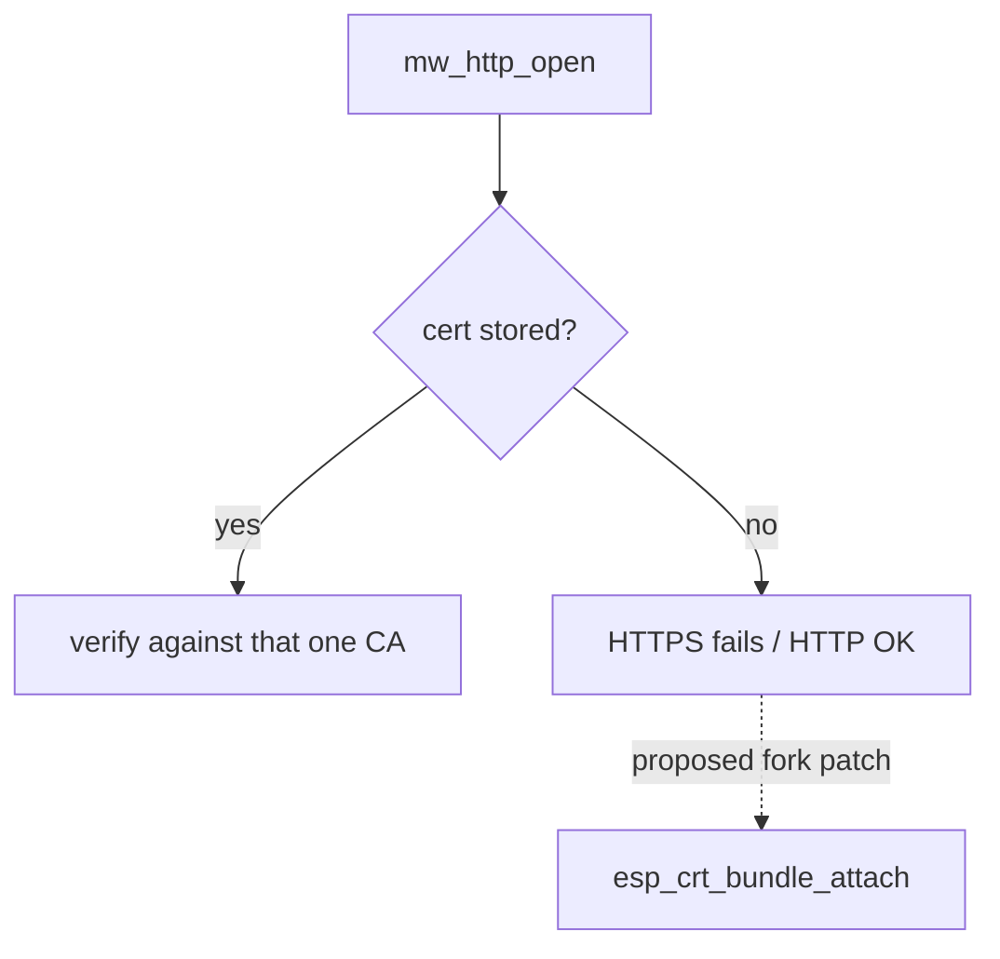

# ESP32 firmware (jfryman/mw-fw-rtos)

- Release **`rev-c-1250k`** (published 2026-10-28). Assets: `mw-fw-rtos-merged.bin` (flash at 0x0)
  and `mw_fw_rtos_esp32c3-rev-c-1250k.tar.xz`.

## HTTPS behaviour (confirmed in `main/http.c`)
```c
esp_http_client_config_t config = {
    .url = url,
    .cert_pem = cert_pem,      /* from the cert partition, or NULL if none is stored */
    .timeout_ms = 60000
};                              /* no .crt_bundle_attach, no skip_cert_common_name_check */
```
- Exactly one PEM CA (≤ `MW_CERT_MAXLEN`) is used, stored via `mw_http_cert_set`. With no cert
  stored, `cert_pem = NULL` and nothing else verifies the server, so esp-tls refuses the HTTPS connection.
- `sdkconfig.defaults` doesn't disable `CONFIG_MBEDTLS_CERTIFICATE_BUNDLE` (on by default in IDF), so
  adding `.crt_bundle_attach = esp_crt_bundle_attach` when `cert_pem == NULL` is a small patch.



Related: [hardware.md](hardware.md), [../architecture/data-path-options.md](../architecture/data-path-options.md).
