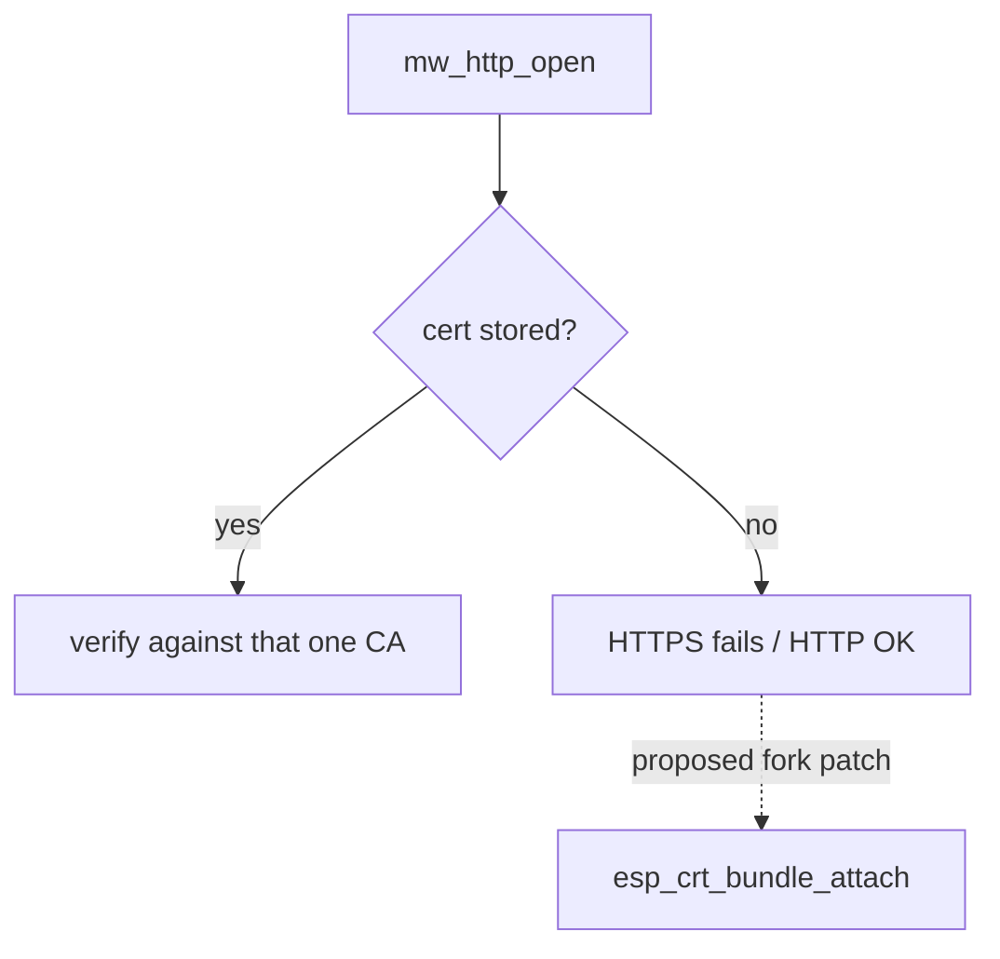

# ESP32 firmware (jfryman/mw-fw-rtos)

- Release **`rev-c-1250k`** (published 2026-10-28). Assets: `mw-fw-rtos-merged.bin` (flash at 0x0)
  and `mw_fw_rtos_esp32c3-rev-c-1250k.tar.xz`.

Flashed with `make esp-flash` ([hardware.md](hardware.md)). esptool writes it in ~3 s at ~2.5 Mbit/s.
After a reset, the USB-Serial/JTAG console (`/dev/cu.usbmodem*`, 115200) shows only the ROM boot
banner and `entry 0x403cc710`, with no app log. So the USB console can't tell whether the app
is healthy; the 68k `mw_detect` is the real check.

## Inactivity sleep
`MwInit` starts a one-shot **30 s** timer (`MW_SLEEP_TIMER_MS`) that calls `esp_deep_sleep_start()`.
Only `MW_CMD_VERSION` (that is, `mw_detect`) cancels it. A module that never hears from the 68k
turns off by design. A 68k reset (EN via DTR) wakes it.

## Partition table (`partitions.csv`)
| name | offset | size | notes |
|---|---|---|---|
| nvs | 0x9000 | 0x5000 | IDF NVS; overwritten by the merged bin |
| otadata | 0xe000 | 0x2000 | |
| ota_0 / ota_1 | 0x10000 / 0x120000 | 1 MiB each | app slots |
| mw_cfg | 0x110000 | 0x8000 | MegaWiFi config (3 AP slots, IP cfg, default slot) |
| cert | 0x118000 | 0x8000 | the single HTTPS CA |
| user_data | 0x220000 | 0x1E0000 | `mw_flash_*` area (~1.9 MiB), for our settings |

## HTTPS behaviour (confirmed in `main/http.c`)
```c
esp_http_client_config_t config = {
    .url = url,
    .cert_pem = cert_pem,      /* from the cert partition, or NULL if none is stored */
    .timeout_ms = 60000
};                              /* no .crt_bundle_attach, no skip_cert_common_name_check */
```
- Exactly one PEM CA (≤ `MW_CERT_MAXLEN`) is used, stored via `mw_http_cert_set`. With no cert
  stored, `cert_pem = NULL` and nothing else verifies the server, so esp-tls refuses the HTTPS connection.
- `sdkconfig.defaults` doesn't disable `CONFIG_MBEDTLS_CERTIFICATE_BUNDLE` (on by default in IDF), so
  adding `.crt_bundle_attach = esp_crt_bundle_attach` when `cert_pem == NULL` is a small patch.



Related: [hardware.md](hardware.md), [../architecture/data-path-options.md](../architecture/data-path-options.md).
