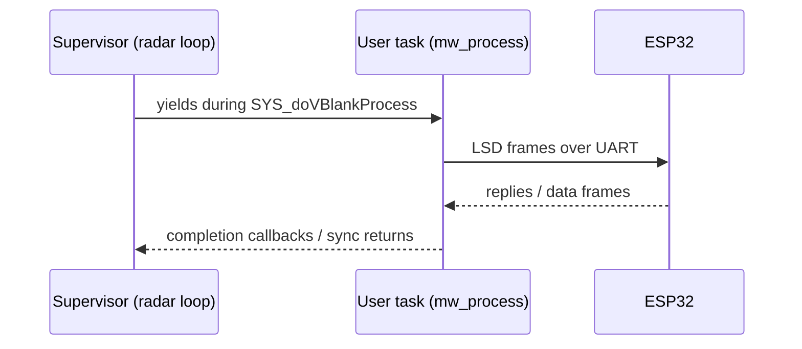

# SGDK + MegaWiFi module

Verified by reading source on 2026-10-28.

## Versions compared
| | v2.11 (`ef9292c`, 2025-04-02) | master (`9a78a44`, 2026-10-20) |
|---|---|---|
| Enable | `MODULE_MEGAWIFI 1` only | `MODULE_MEGAWIFI 1` **and** `MEGAWIFI_IMPLEMENTATION = MEGAWIFI_IMPLEMENTATION_MW_CART` (default is `CROSS\|ED`) |
| Transport | `lsd.c` calls `uart_*` (16C550) directly | `comm.c` driver table: serial / EverDrive / 16C550 (`"MwC"`), probes the UART scratch register |
| ROM header | — | `"SEGA MEGAWIFI   "` system string when the MW_CART impl is on |
| Async API | — | `megawifi_async.h` (callback API, `MODULE_MEGAWIFI_ASYNC 1`) |
| API | v1.5 | v1.5 |
| UART defaults | 24 MHz / 1.5 M | 24 MHz / 1.5 M, plus `UART_BUFLEN 1460` |

**Pinned: master `9a78a44143a867cd8c5053b95cd061a21f0b73c2`**, chosen for the cart's implementation option and the async API.
The pin and patches live in [../build/container-build.md](../build/container-build.md). With master, the default `CROSS` implementation also requires
`MODULE_SERIAL`, so forgetting to set `MW_CART` gives a build error rather than silently broken code.

## Required patch (both versions)
```c
/* inc/ext/mw/16c550.h */
#define UART_CLK  20000000LU
#define UART_BR    1250000LU
/* inc/config.h */
#define MODULE_MEGAWIFI 1
#define MEGAWIFI_IMPLEMENTATION MEGAWIFI_IMPLEMENTATION_MW_CART   /* master only */
```
The patches live in `sgdk/patches/` and the image applies them and rebuilds `libmd.a` automatically.
`MODULE_MEGAWIFI_ASYNC` stays `0` for now. Turning it on overrides `mw_process()` (`MW_PROCESS_OVERRIDE`), so it needs its own patch and a decision first.

## Channels and limits
`LSD_MAX_CH = 4`: ch0 control, ch1–2 sockets, ch3 = `MW_HTTP_CH`. `MW_MAX_SOCK = 3` counts the
HTTP channel. Payload ≤ 1460 bytes per frame.

## Program skeleton
```c
static u16 cmd_buf[MW_BUFLEN / 2];
static void user_tsk(void) { while (1) mw_process(); }   /* never touch the VDP here */

int main(bool hard) {
    TSK_userSet(user_tsk);
    mw_init(cmd_buf, MW_BUFLEN);
    /* blocking setup: mw_detect, mw_ap_assoc + mw_ap_assoc_wait, mw_ip_current ... */
    while (1) { /* radar loop: async mw_send/mw_recv only */ SYS_doVBlankProcess(); }
}
```



Related: [hardware.md](hardware.md), [firmware.md](firmware.md), [../practices.md](../practices.md).
