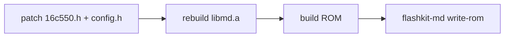

# Practices

## Workflow
- Git: commit at checkpoints (a working step, a settled decision, a lode refresh). Never commit `src/dev_config.h` (it holds Wi-Fi credentials).
- Explore and design first, then implement. Record each decision in the lode before writing code.
- Every script and build step must run on **macOS and Arch Linux (Omarchy)**, never Windows-only.
  Use Podman/Docker for toolchains that aren't packaged natively on both.
- The relay is Go (stdlib only). It builds natively on both OSes (`go test ./...`, `go run .` in `relay/`) or as its own container (`make relay-run`); it doesn't use the SGDK image.
- Develop rendering in emulators against the **fake source**. Test networking only on the real cart.
- Every user-visible change adds a bullet under `## X.Y.Z (Unreleased)` in `CHANGELOG.md`, in the same commit
  (format: [build/ci-release.md](build/ci-release.md)).
- A change to what the player sees or does also updates its manual section in `print/manual/` and, if the
  screen changed, `print/shots.txt` + `make print-shots`, in the same commit ([print/print-assets.md](print/print-assets.md)).
- Contract changes (frame/detail layout, constants, HTTP paths/queries, mDNS strings) start in `src/arframe.h` with an
  `AR_VER` bump; then the relay, then the mapping in `relay/contract_test.go`, then `make contract-lock`. `make contract` (run before every ROM build) and CI enforce it
  ([architecture/contract.md](architecture/contract.md)).
- The relay is part of the cartridge: extend it whenever a cart feature needs it. Relay vX requires cart vX; both
  ship from the same tag. Any contract change bumps `AR_VER`, and mismatches are caught at build time and on screen.
- Printed pieces copy Sega's 1989 *style*, never its marks: no SEGA logo, Genesis wordmark or seal.

## Hard rules for 68k code
- No floats. Use `fix16`/`fix32` and lookup tables. Do geographic projection off-console.
- Never touch the VDP from the user task (`mw_process()` context).
- Never call a blocking `mw_*` function in the radar loop. Blocking calls belong to start-up/setup screens only.
- State shared between the supervisor and SGDK's user task is a data race the compiler can't see.
  With LTO, loops in either task need `__asm__ volatile ("" ::: "memory")` or `volatile` accesses,
  or gcc hoists the loads (see [net/net-layer.md](net/net-layer.md)).
- Soft reset (`main(FALSE)`) keeps RAM and doesn't reload initialised data. Test every hardware path
  from a **cold** power-on, and reset statics at the top of `main` when it matters.
- V-Int code: no sprintf, no SGDK text/sprite helpers, no 32-bit multiply/divide/modulo; grep the disassembly for `jsr __`. See [ui/radar-renderer.md](ui/radar-renderer.md).
- Respect the sprite budget: 80 total, 20 per scanline.
- ROM size ≤ 4 MiB unless there is a reason to go bigger (emulators and tools assume 4 MiB).

## SGDK library must match Rev.C
The UART clock and baud rate are compiled into `libmd.a`. Editing our own sources alone does nothing.

```c
/* inc/ext/mw/16c550.h, as patched for Rev.C */
#define UART_CLK  20000000LU   /* stock: 24000000LU */
#define UART_BR    1250000LU   /* stock: 1500000LU  -> divisor stays 1 */
```



The container build enforces this; see [build/container-build.md](build/container-build.md).

Related: [platform/sgdk-megawifi.md](platform/sgdk-megawifi.md), [platform/hardware.md](platform/hardware.md).
