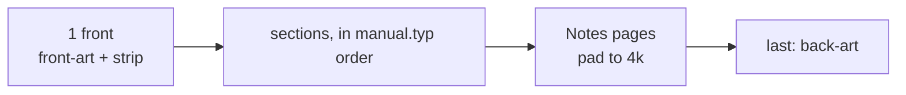

# Instruction manual (`print/manual.typ`, `print/manual/*.typ`)

16 pages at 121×171 mm, laid out like a 1989 Sega manual: white pages, a black heading bar with a red
rule, the page number in a small black box, and red numbered discs for callouts. All the text is our own.



## Page map (current)
| Page | Section file | Content |
|---|---|---|
| 1 | — | `front-art(w, h, strip: "INSTRUCTION MANUAL")` |
| 2 | handling | care, seizure warning, projection/plasma burn-in, not-for-navigation note |
| 3 | contents | `outline(depth: 1)`, thank-you line |
| 4–5 | starting-up | Model 1 top + front with callouts, 3 steps, first time, if nothing appears, what you need |
| 6 | controls | pad drawing + 5 keys, range steps |
| 7 | relay | what the relay is, docker command, URL rules, adsb.fi fair use |
| 8–9 | setup | `setup` shot + 5 keys, `keyboard` shot, persistence, airport count |
| 10–11 | scope | `radar` shot + 7 keys, tag colours table, stale/drop |
| 12 | themes | Classic + STARS shots |
| 13 | troubleshooting | boot/panel messages table, Wi-Fi sleep note |
| 14 | credits | credits grid, version, URL, disclaimer |
| 15 | (pad) | Notes |
| 16 | — | `back-art`: small scope, wordmark, URL + version, disclaimer |

## Building blocks (`print/manual/lib.typ`)
```typst
#shot("radar", width: 80%, callouts: ((1, 85, 40),))   // callouts in 320x224 screen pixels
#step(1, [Lead in bold.], [rest of the step])
#key(3)[Button A][Zoom in...]                          // legend matching a marker
#controls(([ERR HTTP], [The relay can't be reached...]),)
#note[Important][Always turn the power OFF...]
```
Hardware drawings (`hardware.typ`) take callouts in their own units: Model 1 top 280×212, front 280×46,
pad 180×112, cartridge 100×120.

## Invariants
- Level-1 headings start a new page (a weak pagebreak in the show rule). Each section must fit the pages
  it's given; check `out/print/manual-N.png` after edits. An overflow shifts every later page and the padding.
- The padding counts the page that holds the end of the content. If the last page is exactly full, the
  context lands at the top of an empty page, and that page isn't counted (`p.y < bleed + slug + 20mm`).
- `booklet.typ` asserts that the page count is a multiple of 4. `scripts/print` passes the count from the PNG previews.
- To place callouts on a shot, render it with a 20 px grid overlay (scratch Typst file) and read the
  coordinates off it. Guessing from the display always misses.

## Adding a feature
Write or extend a section file (add new ones to `sections` in `manual.typ`). If the screen changed, add a
line to `print/shots.txt`, run `make print-shots` (MAME image needed), and commit the PNGs. Then rebuild and check the pages.

Related: [print-assets.md](print-assets.md).
