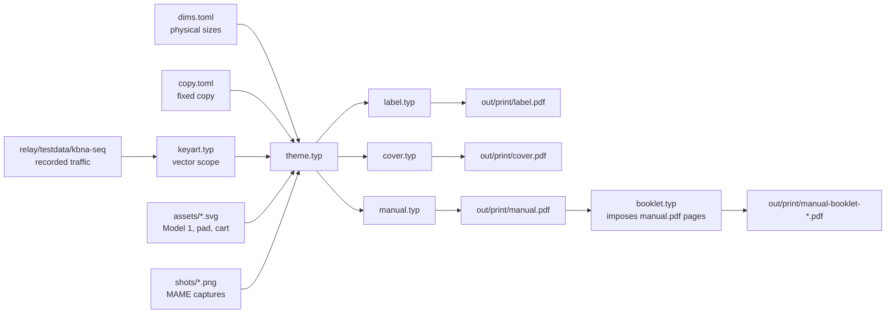

# Print assets: label, cover, manual (`print/`, Typst)

A cartridge label, a front cover for the clamshell sleeve, and a manual, built from one shared
theme, fixed copy and the same key art so they read as one product. They copy the look of a 1989
US Genesis release (black grid, red banner, bold italic title) but use **no Sega marks**: no SEGA
logo, Genesis wordmark or Seal of Quality. "Sega Genesis" appears only as plain descriptive text.



## Decisions (agreed 2026-10-28)
- Target: **original Sega clamshell + stock-style shell**. Sizes come from published 300 dpi
  templates and listings, so they're unverified until a test print. They live only in `dims.toml`:
  label 80.5×77 mm, cover front 130×178 mm, manual 121×171 mm, bleed 3 mm.
- Key art is **generated vector art**: `keyart.typ` reads the recorded KBNA traffic and draws the scope
  (rings, conic-gradient sweep, blips, 5-point trails, tags) the way the game does. It stays sharp at any
  size and needs no extra generator.
- Manual outputs **both** single trim-size pages with bleed and crop marks (for a print shop) and
  imposed saddle-stitch booklets on Letter and A4 (for home duplex printing, flipped on the short edge).
- Toolchain: **Typst 0.15.1** in its official image, pinned by digest (`scripts/print`). The fonts are
  bundled OFL fonts in `print/fonts/` with `--ignore-system-fonts`, so output is the same on every machine.
- The manual follows the structure of early Sega manuals, written in our own words: Starting Up
  (Model 1, numbered steps), Take Control!, the feature pages, Handling This Cartridge, warnings, and Notes pages as padding.

## Contracts
- Every page builds on a **print box** (`theme.printed`): the page is the trim size plus bleed plus a 9 mm slug
  that carries the crop marks. `--input marks=false` drops the slug (the booklet input and the previews use this).
- Manual page count is padded to a multiple of 4 with Notes pages, so the booklet imposition always works.
- Screenshots come from the emulator build (`make print-shots`, `print/shots.txt`: name, snapshot time,
  presses) and are committed, because CI has no MAME. Typst draws them with `scaling: "pixelated"`.
- A user-visible feature updates its `print/manual/*.typ` section, the CHANGELOG and, if the screen
  changed, the shots, all in the same commit.

## Files
| File | Role |
|---|---|
| `dims.toml` / `copy.toml` | sizes (mm) / shared copy |
| `theme.typ` | `ink`, `font`, `cond` (Barlow at 75% stretch = Barlow Condensed), `printed()`, `grid-tiling`, `banner`, `wordmark`, `title-lockup`, `badge`, `art-window` |
| `keyart.typ` | `scope(d, rim-nm, sweep, tags, tag-size, detail, view)`; tags use the first free spot of 4, kept inside `view` |
| `front.typ` | `front-art(w, h, strip)`: the box front scaled from the 130 mm reference; used by the cover and manual page 1 |
| `label.typ`, `cover.typ`, `manual.typ`, `booklet.typ` | the pieces; manual details in [manual.md](manual.md) |
| `hardware.typ` | Model 1 top/front, pad, cartridge drawings + `marker(n)` |
| `shots.txt`, `shots/` | screenshot list and committed PNGs (`scripts/print-shots`) |
| `fonts/` | Barlow, Barlow Condensed, Press Start 2P (OFL) |

`scripts/print [all|label|cover|manual|watch <piece>]` writes `out/print/<piece>.pdf` (marks), `-trim.pdf`,
`-N.png` (150 dpi), and `manual-booklet-{us-letter,a4}.pdf`. The Typst root is the repo (`json("/relay/...")`).

```sh
make print                     # scripts/print: all pieces -> out/print/
scripts/print watch manual     # live rebuild while editing (marks off)
make print-shots               # recapture print/shots/*.png from the emulator build
```

## Typst lessons
- `place()` with no alignment sits at the current *flow* position. Use `place(top + left, ...)` for absolute placement.
- Closures capture by value: an overlap test over a list that grows in the loop must be rebuilt each iteration.
- Parameters named `range`, `line`, `h`, `left`, `top` shadow built-ins. Rename them (`rim-nm`, `at-left`...).
- `gradient.conic` angle: for a sweep at bearing θ (clockwise from north) with a trailing glow, use `angle: θ + 90deg`
  and put the bright stop at 100%.
- Barlow Condensed's static files register as family "Barlow" with stretch 75%.

Related: [../build/ci-release.md](../build/ci-release.md), [../ui/screen-layout.md](../ui/screen-layout.md).
