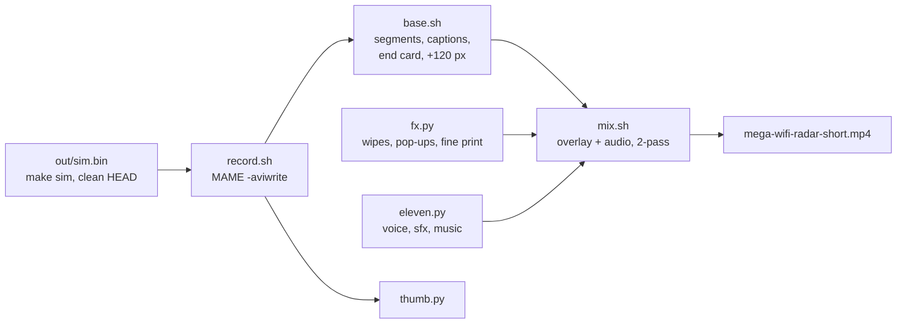
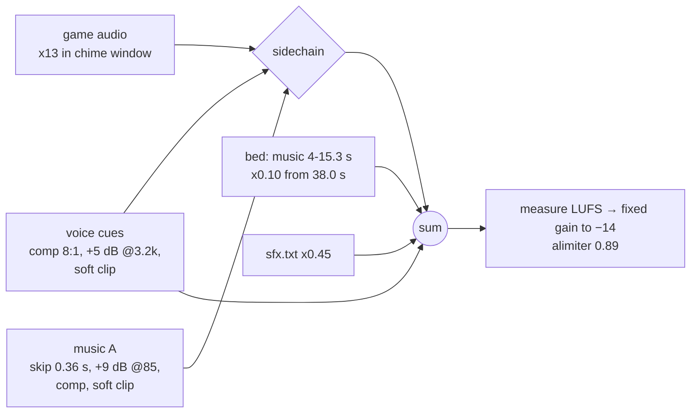

# YouTube Short (`promo/short/`)

A 49 s vertical (1080×1920, 60 fps) ad in a loud 90s-TV style, published at
https://www.youtube.com/shorts/zIt93wNQCUw and linked as "Watch the trailer" under the README's top images. Real ROM footage from the emulator build, a shouting announcer,
wipes and pop-up stickers, original 16-bit action music and an infomercial fine-print read. The pipeline is
committed. **Media never is:** everything renders into `out/promo/work/` (git-ignored, under `out/`).

```sh
promo/short/short.sh            # all: record base voice sfx music fx mix thumb
promo/short/short.sh fx mix     # any steps, in order; output: out/promo/work/mega-wifi-radar-short.mp4
MUSIC_VOL=1.3 BED_VOL=0.08 promo/short/short.sh mix   # mix knobs are env vars (mix.sh header)
```



## Files
| File | Role |
|---|---|
| `short.sh` | driver: steps, `$W` = `out/promo/work`, a venv in `$W/venv` (Pillow) |
| `record.sh` | 5 headless MAME runs in parallel (`boot radar cockpit themes logbook`) → `$W/rec/*.avi,wav` |
| `base.sh` | the game at 3× nearest in a framed window (960×672 at 60,560) on the box art's 40 px grid; Press Start 2P captions; segment table; end card |
| `eleven.py` | ElevenLabs takes: announcer lines, fine print, 8 SFX, music track "A" (prompts, voice IDs, settings) |
| `lines.txt` | announcer text with v3 delivery tags (`[shouting]`, `[whispers]`…) |
| `cues.txt` | when each voice clip plays, its trim, and its chain (`echo`, `big`, `fine`) |
| `fine.txt` | the fine print (read by Eric at 1.2× then `atempo=2.0`; also drawn on the end card) |
| `fx.py` | 30 fps RGBA overlay: `TRANS` (wipe per cut), `POPS` (stickers), fine print; writes `sfx.txt` |
| `mix.sh` | final cut; the audio graph below |
| `thumb.py` | 1080×1920 thumbnail from `rec/radar.avi` @39.2 s and `rec/cockpit.avi` @30 s |

## Timeline (output seconds)
| t | picture (`base.sh` segment) | voice (`cues.txt`) | fx |
|---|---|---|---|
| 0.0 | boot: takeoff (banner hides EMULATOR BUILD) | "Your Sega Genesis… just got" | NEW! |
| 2.6 | | **"WI-FI!"** + 3-tap echo, music beat drops | WI-FI!! |
| 5.2 | radar, 28 aircraft, weather | "Real planes! Real time!…" | star wipe, LIVE!, REAL PLANES! |
| 9.8 | radar → LOOK UP! box | "And when one flies over your house…" | checker wipe |
| 11.8–13.8 | the cart's chime **alone** | — | — |
| 13.7 | | **"LOOK UP!"** | WHOA! |
| 15.2 | detail pop-up | "Pick ANY plane… ride along… in 3-D!" | iris, 3-D!! |
| 16.6 | cockpit ride | | stripes |
| 20.2 | cockpit OVERHEAD! | "Real terrain! Totally radical!" | zig-zag, TOTALLY RADICAL! |
| 23.2 | themes: STARS AMBER NIGHT MARINE POCKET SUNSET ERAM | "Nine radar themes! *Pick your scope.*" | x9! |
| 29.3 | logbook page | "It even keeps a LOGBOOK!" | WAY PAST COOL! |
| 31.9 | end card (title, GitHub, BUILD YOUR OWN CART) | "Mega… WiFi… RADAR! Free and open source!" | sunburst + orch hit, 100% FREE!* |
| 38.2–48.0 | end card + on-screen fine print | fast fine print, music bed under it | |

**Invariant:** three files share this clock. Changing a segment length in `base.sh` moves every later
`TRANS`/`POPS` entry in `fx.py` and every later line in `cues.txt`. `FINE_AT` (fx.py) = the `fine` cue.

## Audio graph (`mix.sh`)

- The voice ducks the game hard (8:1) and the music lightly (1.8:1, ~3–4 dB): the owner wanted the music
  driving through the lines, not dropping out.
- The chime window (11.8–13.8) multiplies music and SFX by ~0.1 and lifts the game ×13, because the recorded
  FM chime is ~20 dB under everything else.
- Music A's build-up lasts 3.0 s; skipping 0.36 s puts its first full beat on "WI-FI!" (2.64 s). It ends
  on its own big hit ~37 s, so the fine print gets a separate low **bed** (the same track's 4–15.3 s).
- Loudness: two passes with a **fixed** gain. Single-pass `loudnorm` lifts the quiet fine print.

## ElevenLabs
- Key: `~/.config/elevenlabs/api_key`. The account is Creator tier: `mp3_44100_192` needs it (128 kbps below).
- Announcer: **Adam** (`pNInz6obpgDQGcFmaJgB`) on `eleven_v3` (stability 0, style 0.8). v3 acts the bracketed tags
  and doesn't speak them. Fine print: **Eric** (`cjVigY5qzO86Huf0OWal`), `eleven_multilingual_v2`, speed 1.2.
- Music: `/v1/music`, `music_v1`, 38 s, instrumental. The prompt describes a style ("early 1990s jungle stage")
  and never names a game, so the track is original and needs no licence. Paid-plan output is cleared for commercial use.
- **Takes aren't reproducible.** `eleven.py` never overwrites an existing file; the published takes live only in
  `out/promo/work/{vo,sfx,music}` on the owner's Mac. Delete a file to get a new take (it costs credits).
- Check every take with speech-to-text (`/v1/speech-to-text`, `scribe_v1`). Cut test clips with some lead-in:
  a clip that starts on a word gets misheard, which looks like masking but isn't.

```sh
K=$(tr -d '[:space:]' < ~/.config/elevenlabs/api_key)
curl -s -H "xi-api-key: $K" -F model_id=scribe_v1 -F file=@clip.m4a https://api.elevenlabs.io/v1/speech-to-text
```

## Reproducibility
- MAME runs are deterministic: two `record base` runs give a bit-identical `base.mp4`.
- The themes run waits until 20 s for its first press. With presses at 18 s, the same ROM and presses gave
  different results in separate sessions: once START was swallowed and every theme shifted (the published cut
  has that run: 10/5 nm ranges, three theme stills). The cause isn't proven. The suspect is START landing on
  the end of the boot (~17 s); 20 s leaves room. Back-to-back runs at 20 s are bit-identical.
  The committed cut uses 25 nm and video for all seven themes. Rebuilt from the kept takes, it matches the
  published Short everywhere else (inf dB to 29 s, ~50 dB after: x264 rate control only).
- `make sim` from a clean HEAD first. A stale `out/sim.bin` once carried a one-aircraft arrival feed.

## Lessons
- MAME `-aviwrite` takes its size from the **first** frame. The boot is H32 (256 px), so without
  `-snapsize 320x224` every H40 frame was cropped. The AVI path is relative to `-snapshot_directory`.
- Black text with a black stroke can't be read (`sticker(..., INK)`): give the text a colour.
- A changing on-screen number ("28 REAL PLANES") goes stale within a second. The aircraft count moves.
- Keep the content between y≈270 and 1500: Shorts' title, channel and buttons cover the bottom and right.
- Custom thumbnails for Shorts depend on the account and app. Frame picks: 0:03, 0:34.
- Same rule as print: Sega's 1989 *style*, no Sega marks; "Sega Genesis" only as plain text.

Related: [../print/print-assets.md](../print/print-assets.md) (the box look, `print/shots/`),
[../build/container-build.md](../build/container-build.md) (`make sim`), `scripts/sim` + `sim/snap.lua` (MAME presses).
