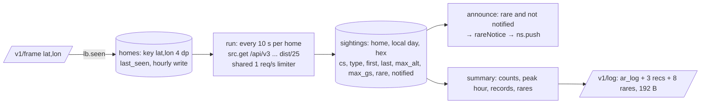

# Relay logbook (`relay/logbook.go`, SQLite)

The relay logs the traffic around every home a cart has asked about, all the time it runs, and serves today's
summary as `/v1/log` (contract v7, cart side: [../ui/logbook.md](../ui/logbook.md)). Rare aircraft raise notices
through the flyover ring ([../ui/notices.md](../ui/notices.md)). Owner's decisions 2026-11-02: always logging,
SQLite, local midnight at the airport, homes remembered from carts.

## Storage
- `modernc.org/sqlite` (pure Go): the **first relay dependency** (owner chose SQLite 2026-11-02); CGO stays off, so
  the static amd64/arm64 cross-compile and distroless image still work. Needs Go 1.26 (`go.mod`, Dockerfile).
- `-db` / `RELAY_DB`: a file (`/data/relay.db` in the image; `scripts/relay` mounts the `mwradar-data` volume and sets
  it). Empty: an in-memory DB (`file:relaylog?mode=memory&cache=shared`), lost on restart. `file:` URIs pass through
  (tests use one named DB each). One connection (`SetMaxOpenConns(1)`), WAL.
- Upsert per aircraft per snapshot: `ON CONFLICT (home, day, hex)` keeps max altitude / speed, the latest callsign and
  type, ORs the rare bits. One transaction per snapshot.

## Days and homes
- **Day** = `YYYY-MM-DD` in the home's zone. Zone = the nearest airport in `airport_tz.csv` (`tools/tzgen`: the 1,142
  cart airports, each with the nearest GeoNames city ≥ 15,000's IANA zone, CC BY 4.0) → `time.LoadLocation`, with
  `time/tzdata` embedded (distroless has no zoneinfo). Checked: KBNA Chicago, EGLL London, KPHX Phoenix.
- **Homes**: key `"%.4f,%.4f"` of the frame's lat/lon. New ones are logged at once; `homes.last_seen` is written at
  most hourly; reloaded at start if seen in the last 30 days (`logForget`).
- `since` (minute of the local day) is set when this process started logging the home after midnight, so the cart
  can say LOGGED FROM 13:05 (gaps from relay downtime aren't tracked).

## Rare and private
- adsb.fi `dbFlags` (checked 2026-11-02): 1 military, 2 interesting, 4 PIA, 8 LADD. PIA/LADD: never stored.
- Rare = military (`AR_R_MIL`) | interesting (`AR_R_FLAGGED`) | `rareTypes` (`AR_R_TYPE`: A388, A124, A3ST, A337,
  B748, BLCF, MD11, DC10, IL76, AN12, A400, C5M, C17, B52, B1, B2, U2, E3TF/E3CF, E6, P51, B17, B25, B29, SPIT, CONC).
- Military is routine near BNA (ANG C-130s, Army helicopters): one notice per aircraft per local day (`notified`).
  Notice: `MILITARY!`/`RARE!` + callsign, adsb.fi `desc` (or type), `21 NM NW  2,775FT` (8-point bearing).
- Live check 2026-11-02 at KBNA: 28 aircraft / 19 types in the first 35 s, a CH-47 announced.

## Summary
Counts (aircraft, distinct types), peak hour by first-seen hour, records fastest (kt), highest (alt / 100: FL),
longest in range (minutes), rares newest first (≤ 8). `lNew` when nothing is logged today.

## Tests (`logbook_test.go`)
`homeZone`; a replay of `testdata/kbna-seq` (counts = unique aircraft within 25 nm, LADD excluded, one notice per
military aircraft, encode); local-midnight rollover (Chicago 23:59 → 00:01 is a new day); persistence across a
reopen (homes reloaded); the handler. Contract test maps `ar_log`, `ar_log_rec`, `ar_log_rare`.

Related: [relay.md](relay.md), [../data/adsb-sources.md](../data/adsb-sources.md).
