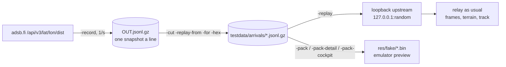

# Recordings: record, cut, replay (`relay/record.go`)

Real traffic on demand: the relay saves the upstream's answers around a point, trims them to one event (an arrival),
and serves a recording back as its own upstream, so the real cart (or the emulator) can fly a recorded landing
whenever it's needed. Built for cockpit mode near the ground ([../ui/cockpit.md](../ui/cockpit.md)); the arrivals
plan uses it for its classifier ([../plans/watch-arrivals.md](../plans/watch-arrivals.md)).



## Format
gzip, one upstream answer per line, compacted (`{"now":<ms>,"ac":[...]}` as adsb.fi sent it). A failed poll is
logged and skipped (adsb.fi's 429s happen when the dev relay polls too: both share the 1 req/s limit).
```sh
cd relay && go run . -record /tmp/bna.jsonl.gz -lat 36.1245 -lon -86.6782 -range 12 -for 75m
go run . -cut testdata/arrivals/x.jsonl.gz -replay-from 590s -for 340s /tmp/bna.jsonl.gz   # -hex abc123,... keeps only those
```
`-for` is shared: how long `-record` runs (0: until stopped) and how much `-cut` keeps (0: to the end).
A recording that is still being written isn't a valid gzip yet; decompress what's there and drop the last line.

## Replay (`replay`, `serveReplay`)
- `-replay FILE` (`RELAY_REPLAY`) starts `replay.handler()` on a loopback port and makes it `-upstream`.
- The snapshot playing is chosen by wall time since start (+ `-replay-from`), **looping** (the last snapshot plays a
  second); `now` is rewritten to the wall clock, so `seen_pos` ages and the logbook clock behave as live.
- `/api/v3/lat/{lat}/lon/{lon}/dist/{d}` returns every aircraft (the relay filters by range itself);
  `/api/v2/hex/{hex}` returns that aircraft from the current snapshot (`~` prefixes ignored).
- The logbook stays **in memory** while replaying (`-db` is cleared), so recorded aircraft never reach the real one.
- **Standard cart test** ([../practices.md](../practices.md)): `make replay` (`REC=`, `REPLAY_ARGS=`), `make record`
  (`LAT`, `LON`, `RECORD_FOR`, `RECORD_OUT`).
- `scripts/relay replay FILE [args]` runs it in the container in the foreground, mounting the file, and stops the
  detached `mwradar-relay` first (port 8080), names its container `mwradar-replay` and uses `-it` only from a
  terminal (so it also runs in the background); `make relay-start` brings the normal relay back.

## Fixtures (`relay/testdata/arrivals/`, adsb.fi terms in `testdata/NOTICE.md`)
| File | Aircraft | Runway | Window |
|---|---|---|---|
| `kbna-20l-swa3092-b38m.jsonl.gz` | SWA3092 `ac3751` | 20L | ~4,000 ft → 1 min after touchdown, 340 s |
| `kbna-20r-scx3003-b738.jsonl.gz` | SCX3003 `aac5ec` | 20R | ~4,000 ft → 1 min after touchdown, 376 s |

Recorded 2026-11-02, everything within 12 nm. `TestArrivalRecordings` flies both through `buildTrack`.

## Facts learned from real arrivals
- **Position gaps near the ground:** every BNA arrival recorded had a 20-70 s gap in positions below 1,500 ft
  (receivers lose it low). The relay keeps serving the last fix with a growing age; the cart extrapolates and its
  ground clamp holds the camera above the terrain until the next fix snaps it on.
- **Geoid:** on the ground at BNA (599 ft) `alt_geom` reads ~500 ft: the ellipsoid height. +98 ft (EGM96) = field.
- Low fixes are quantised (25 ft) and noisy: SWA3092 reports 425 ft geometric over a 20L that is higher.
- adsb.fi often answers the same aircraft data twice, a second apart (`seen_pos` unchanged): whichever answer a fix
  comes from shifts its position time by a second. Anything derived from successive fixes (turn rate) needs a
  baseline of several seconds; a test polling like the cart (every ~2.1 s, newest snapshot) catches it.
- `nav_qnh` is sent by airliners on approach (1020.8 hPa that day): baro + 30 ft/hPa lands within ~70 ft of GPS.

## Emulator preview of an arrival
```sh
cd relay
go run . -pack ../res/fake/kbna_seq.bin -lat 36.1245 -lon -86.6782 -range 25 ARR.jsonl.gz
go run . -pack-detail ../res/fake/kbna_detail.bin ARR.jsonl.gz
go run . -sky day -pack-cockpit ../res/fake/kbna_cockpit.bin -lat 36.1245 -lon -86.6782 -cell 60 ARR.jsonl.gz
cd .. && make sim && SIM_PRESS="21:P1 Down,22:P1 C,24:P1 A" scripts/sim out/sim.bin 60,90,120
git checkout res/fake   # or make fake-feed: the committed packs are the kbna-seq demo
```
`-cut -hex` one aircraft first, so it's the only one in the list. The emulator's patch is fixed (its strips tile it), so
only the last ~3.8 km around the airport are real ground at 60 m cells.

Related: [relay.md](relay.md), [../ui/cockpit.md](../ui/cockpit.md), [../plans/watch-arrivals.md](../plans/watch-arrivals.md).
