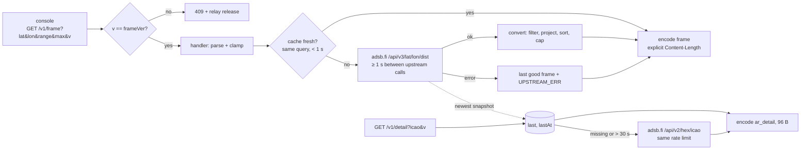

# Relay (option A) — `relay/`, Go

A small HTTP service that polls adsb.fi over HTTPS, turns its JSON into the compact frame
([../architecture/frame-format.md](../architecture/frame-format.md)), and serves it over plain HTTP
to the console. Pure Go stdlib, no dependencies. Builds natively on macOS and Arch (`go` is packaged on both).



## Contract
- **Version:** `version` (the release, `-ldflags -X main.version`; `VERSION` build arg from CI's semver tag or
  `git describe` in `scripts/relay build`) and `frameVer` (= `AR_VER`, 2). Every route but `/healthz` needs
  `v=frameVer`; anything else → `409` (`httpMismatch`) with *"relay vX speaks v2: use the relay and cartridge
  from the same release"*, logged with both versions. The start-up log names both.
- `GET /v1/frame?lat=<deg>&lon=<deg>&range=<nm>&max=<n>&v=2`. `range` is clamped to 1–250 (the adsb.fi
  limit) and `max` to 1–96. Missing or invalid `lat`/`lon` → `400`.
- `200`, `application/octet-stream`, **explicit `Content-Length`**. Go's `net/http` would otherwise
  switch to chunked encoding for bodies over its 2 KiB buffer, and a full frame is 2,320 B.
- Upstream failure with a cached frame → that frame with `hflags |= UPSTREAM_ERR`. With no cached frame → `502`.
- `GET /v1/detail?icao=<6 hex>&v=2` → one `ar_detail` (96 B, `detail.go`): from `source.last` (the newest upstream
  snapshot, any query) if it's < 30 s old and has the aircraft, else `/api/v2/hex/<icao>` through the same
  1 req/s limiter. Unknown aircraft → a record without `AR_D_FOUND` (still 200). Strings are space padded ASCII;
  other bytes become `?` (`padASCII`, shared with callsigns).
- `GET /healthz` → `ok`.
- `-pack-detail OUT FILES...` writes the emulator's detail pack (`"FD"`, u16 count, records; `make fake-feed`).
- See "Running it" below. The console URL is
  found over mDNS (AUTO) or typed as `http://<relay-host-fqdn>:8080` (see "Discovery" below).

The relay's constants, encoder, route and mDNS strings are held to `src/arframe.h` by `contract_test.go`
([../architecture/contract.md](../architecture/contract.md)).

## Running it
| How | Command |
|---|---|
| native | `cd relay && go run . -listen :8080` |
| container, foreground | `make relay-run` (= `scripts/relay run [relay args]`) |
| published image | `docker run -d --network host ghcr.io/jfryman/mega-wifi-radar-relay:latest` (amd64 + arm64, built by CI; host network so its mDNS reaches the LAN) |
| container, background | `make relay-start` / `scripts/relay logs` / `make relay-stop` |

`relay/Dockerfile` is multi-stage. `golang:1.24-bookworm` (on `$BUILDPLATFORM`) runs `go vet` and `go test` and
cross-compiles a static binary (CGO off, `GOOS/GOARCH` from `TARGETOS/TARGETARCH`). It's copied onto `gcr.io/distroless/static-debian12:nonroot`, which has the CA certificates
the HTTPS upstream needs, runs as non-root, and is ~15 MB. `scripts/relay` picks podman, then docker
(override with `CTR=`), publishes `${RELAY_PORT:-8080}`, and names the detached container `mwradar-relay`
(`--restart unless-stopped`).
On Docker Desktop (macOS) the request log shows the NAT address `192.168.65.1`, not the console's IP;
on Linux you see the real client.

## Conversion (adsb.fi `ac[]` → record)
| Field | Rule |
|---|---|
| keep | has `lat`/`lon`, `seen_pos` ≤ 60 s, great-circle distance ≤ `range` |
| order | nearest first, then the first `max` (`TRUNCATED` if more) |
| icao | `hex` (leading `~` for non-ICAO addresses stripped), 24-bit |
| x, y | azimuthal equidistant: haversine distance d and bearing θ, x = d·sinθ, y = d·cosθ, ×32, rounded, clamped to s16 |
| alt | `alt_baro` / 25, rounded. `"ground"` → `GROUND` with alt 0. Missing → `ALT_UNK` |
| gs | `gs` / 2, rounded, saturating at 255. Missing → `GS_UNK` |
| track | `track` × 256 / 360, rounded, mod 256 (359.9° → 0). Missing → `TRK_UNK` |
| vrate | `baro_rate` (else `geom_rate`) / 64, rounded, saturating at ±127. Missing → `VR_UNK` |
| squawk | the 4 digits as nibbles (`"7700"` → `0x7700`). Missing → `0xFFFF` |
| EMERG | `emergency` ≠ `none`, or squawk 7500/7600/7700 |
| STALE | `seen_pos` > 15 s |
| cat | `"A3"` → `0x03`, `"B1"` → `0x11`. Missing → `0xFF` |
| cs | `flight` trimmed → `r` → hex upper-case. Upper-cased, non-printables → space, padded or truncated to 8 |
| header | `time` = upstream `now` / 1000; `seq` +1 per successful upstream fetch; `source` = 1 (adsb.fi) |

## Offline conversion (fake source for the ROM)
`go run . -convert testdata/kbna-25nm.json -lat 36.1245 -lon -86.6782 -range 25 -o kbna.bin`
writes one frame. The ROM's fake data source and the golden tests use these files.

## Discovery
**mDNS, `_mwradar._tcp`** (`relay/mdns.go`, stdlib only, `-mdns` default on). See [../net/discovery.md](../net/discovery.md).
It answers legacy unicast queries (the cart's), normal mDNS queries (multicast reply, so `dns-sd -B` works) and QU
queries. The A record uses the interface whose subnet holds the querier. Tests: `mdns_test.go` (the cart's exact query).
A bridged or VM container can't advertise on the LAN: `scripts/relay start|run` runs the container with `-mdns=false` and
registers the service on the host (`dns-sd -P "MegaWiFi Radar" _mwradar._tcp local <port> mwradar-relay.local <lan-ip>` on
macOS, `avahi-publish -s` on Linux; pid in `.tools/relay-mdns.pid`; `scripts/relay advertise` re-registers after a reboot).
macOS: a native relay needs "Local Network" permission to answer. The same permission blocks multicast *sends* from
terminal tools, which is why a Python probe on the Mac fails with `EHOSTUNREACH`; test from the cart.

Typed URLs still work: the console's DHCP lease gives it the router's DNS and lwIP resolves through it. Use the
**FQDN**, because lwIP ignores the DHCP search domain. The firmware has no mDNS resolver, so `.local` *host names* don't
resolve: discovery returns an IP. The ESP32's own DHCP hostname is fixed at `MegaWiFi-1-5`.

```sh
scripts/relay start            # container (-mdns=false) + host dns-sd/avahi advertisement
dns-sd -L "MegaWiFi Radar" _mwradar._tcp local   # -> mwradar-relay.local.:8080 v=2 path=/v1/frame
cd relay && go test ./...      # includes mdns_test.go (the cart's exact query)
```

## Terms of use
adsb.fi open data: personal non-commercial use, at most 1 req/s, attribution required. The relay sends
`User-Agent: mega_wifi_radar-relay`, and `source = 1` makes the console show "Data: adsb.fi".

Related: [../data/adsb-sources.md](../data/adsb-sources.md), [../net/net-layer.md](../net/net-layer.md).
