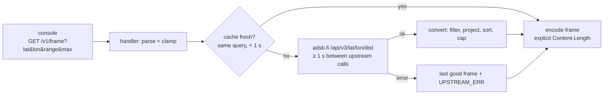

# Relay (option A) — `relay/`, Go

A small HTTP service that polls adsb.fi over HTTPS, turns its JSON into the v1 compact frame
([../architecture/frame-format.md](../architecture/frame-format.md)), and serves it over plain HTTP
to the console. Pure Go stdlib, no dependencies. Builds natively on macOS and Arch (`go` is packaged on both).

## Contract
- `GET /v1/frame?lat=<deg>&lon=<deg>&range=<nm>&max=<n>`. `range` is clamped to 1–250 (the adsb.fi
  limit) and `max` to 1–96. Missing or invalid `lat`/`lon` → `400`.
- `200`, `application/octet-stream`, **explicit `Content-Length`**. Go's `net/http` would otherwise
  switch to chunked encoding for bodies over its 2 KiB buffer, and a full frame is 2,320 B.
- Upstream failure with a cached frame → that frame with `hflags |= UPSTREAM_ERR`. With no cached frame → `502`.
- `GET /healthz` → `ok`.
- Run it: `cd relay && go run . -listen :8080`. The console URL is
  `http://<relay-host-fqdn>:8080/v1/frame` (DHCP-registered DNS; see "Discovery" below).

## Conversion (adsb.fi `ac[]` → record)
| Field | Rule |
|---|---|
| keep | has `lat`/`lon`, `seen_pos` ≤ 60 s, great-circle distance ≤ `range` |
| order | nearest first, then the first `max` (`TRUNCATED` if more) |
| icao | `hex` (leading `~` for non-ICAO addresses stripped), 24-bit |
| x, y | azimuthal equidistant: haversine distance d and bearing θ, x = d·sinθ, y = d·cosθ, ×32, rounded, clamped to s16 |
| alt | `alt_baro` / 25, rounded. `"ground"` → `GROUND` with alt 0. Missing → `ALT_UNK` |
| gs | `gs` / 2, rounded, saturating at 255. Missing → `GS_UNK` |
| track | `track` × 256 / 360, rounded, mod 256 (359.9° → 0). Missing → `TRK_UNK` |
| vrate | `baro_rate` (else `geom_rate`) / 64, rounded, saturating at ±127. Missing → `VR_UNK` |
| squawk | the 4 digits as nibbles (`"7700"` → `0x7700`). Missing → `0xFFFF` |
| EMERG | `emergency` ≠ `none`, or squawk 7500/7600/7700 |
| STALE | `seen_pos` > 15 s |
| cat | `"A3"` → `0x03`, `"B1"` → `0x11`. Missing → `0xFF` |
| cs | `flight` trimmed → `r` → hex upper-case. Upper-cased, non-printables → space, padded or truncated to 8 |
| header | `time` = upstream `now` / 1000; `seq` +1 per successful upstream fetch; `source` = 1 (adsb.fi) |

## Offline conversion (fake source for the ROM)
`go run . -convert testdata/kbna-25nm.json -lat 36.1245 -lon -86.6782 -range 25 -o kbna.bin`
writes one frame. The ROM's fake data source and the golden tests use these files.

## Discovery
None needed. The console's DHCP lease gives it the router's DNS (`192.168.1.1` here), and lwIP
resolves through it. The router answers both bare names and the DHCP domain for DHCP clients
(`relay-host` and `relay-host.example.lan` → `192.168.1.20`). Use the **FQDN**: lwIP ignores the
DHCP search domain, so bare names only work while the router answers them. There's no mDNS in the
firmware, so `.local` names don't resolve. The ESP32's own DHCP hostname is fixed at `MegaWiFi-1-5`
(firmware `MwApJoin`); nothing needs to resolve it.

## Terms of use
adsb.fi open data: personal non-commercial use, at most 1 req/s, attribution required. The relay sends
`User-Agent: mega_wifi_radar-relay`, and `source = 1` makes the console show "Data: adsb.fi".

Related: [../data/adsb-sources.md](../data/adsb-sources.md), [../net/net-layer.md](../net/net-layer.md).
