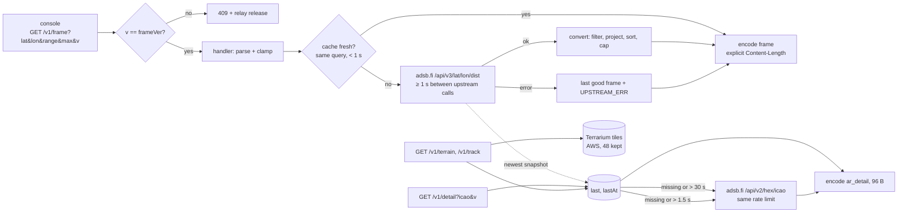

# Relay (option A) — `relay/`, Go

A small HTTP service that polls adsb.fi over HTTPS, turns its JSON into the compact frame
([../architecture/frame-format.md](../architecture/frame-format.md)), and serves it over plain HTTP
to the console, and (optionally) subscribes to the owner's MQTT flight feed for flyover notices. Pure Go stdlib, no dependencies. Builds natively on macOS and Arch (`go` is packaged on both).



## Contract
- **Version:** `version` (the release, `-ldflags -X main.version`; `VERSION` build arg from CI's semver tag or
  `git describe` in `scripts/relay build`) and `frameVer` (= `AR_VER`, 5). Every route but `/healthz` needs
  `v=frameVer`; anything else → `409` (`httpMismatch`) with *"relay vX speaks v5: use the relay and cartridge
  from the same release"*, logged with both versions. The start-up log names both.
- `GET /v1/frame?lat=<deg>&lon=<deg>&range=<nm>&max=<n>&n=<notice id>&w=<weather id>&v=5`. `range` is clamped to 1–250 (the adsb.fi
  limit) and `max` to 1–96. Missing or invalid `lat`/`lon` → `400`.
- `200`, `application/octet-stream`, **explicit `Content-Length`**. Go's `net/http` would otherwise
  switch to chunked encoding for bodies over its 2 KiB buffer, and a full frame is 2,320 B.
- Upstream failure with a cached frame → that frame with `hflags |= UPSTREAM_ERR`. With no cached frame → `502`.
- `GET /v1/detail?icao=<6 hex>&v=5` → one `ar_detail` (96 B, `detail.go`): from `source.last` (the newest upstream
  snapshot, any query) if it's < 30 s old and has the aircraft, else `/api/v2/hex/<icao>` through the same
  1 req/s limiter (`aircraft(ctx, hex, maxAge)`; a hex answer becomes `source.last` when there's no area snapshot). Unknown aircraft → a record without `AR_D_FOUND` (still 200). Strings are space padded ASCII;
  other bytes become `?` (`padASCII`, shared with callsigns).
- Cockpit mode ([../ui/cockpit.md](../ui/cockpit.md)): `GET /v1/terrain?icao=&v=5` → a 32,872 B terrain patch
  centred on the aircraft (`terrain.go`, elevation from `dem.go`; flat with `AR_T_FLAT` if the tiles can't be
  fetched; 404 if the aircraft isn't in the feed; centred 3 s ahead of the aircraft), `GET /v1/track?icao=&p=<patch
  key>&n=&v=5` → a 40 B `ar_track` placed in that patch's grid (`track.go`), and `GET /v1/strip?p=<key>&x=&y=&w=&h=&v=5`
  → more cells of that grid (`stripHandler`; 502 without elevation). Terrain and track look the aircraft up with a
  1.5 s snapshot age; strips need no aircraft. Flag
  `-dem <url>` sets the Terrarium tile base (default AWS Terrain Tiles; the relay needs HTTPS out to it).
  The patch's palette follows the sun at the patch, now (`sky.go`: day / golden / twilight / night, details in
  [../ui/cockpit.md](../ui/cockpit.md)); `-sky` fixes a phase. Cells under city lights get the urban colour
  (`lights.go`, NASA GIBS tiles); `-lights ""` turns that off.
- Flyover notices ([../ui/notices.md](../ui/notices.md)): `n=` on frame and track → `hNotice` / `kNotice` when
  `notices.waiting` (a live notice newer than n; missing n= never waits). `GET /v1/notice?after=<id>&v=5` → one
  82 B `ar_notice` (`noticeHTTP`, `notice.encode`): the oldest live one newer than id, or the zero notice (id 0).
  The ring exists even without MQTT (then always empty); the frame cache holds no flag (set per request on a copy).
- Weather ([../ui/weather.md](../ui/weather.md), `wx.go`): `w=` on frames → `hWx` when it isn't the newest IEM
  NEXRAD scan's id (checked ≤ 1/min in the background; missing w= never waits). `GET /v1/wx?lat=&lon=&range=&v=5` →
  a 190 B `ar_wx`: 26×26 levels sampled from IEM's WMS picture (palette → dBZ, `wxpal.go`), cached per place, range
  and scan; `wNone` outside CONUS, `wOld` when serving a scan > 15 min old after a failed fetch; 502 with nothing.
  `-wx ""` turns it off. `-record-wx OUT -lat -lon -range` saves a picture; `-pack-wx OUT -wx-id N -lat -lon -range
  PNG` writes the emulator's `res/fake/wx.bin`.
- `GET /healthz` → `ok`.
- `-pack-detail OUT FILES...` writes the emulator's detail pack (`"FD"`, u16 count, records; `make fake-feed`).
- `-pack-cockpit OUT -lat -lon -cell M FILES...` writes the emulator's cockpit pack (`"FC"`, a terrain patch, then
  every recorded aircraft's track in it per file; `make fake-feed`, needs the network for elevation).
- See "Running it" below. The console URL is
  found over mDNS (AUTO) or typed as `http://<relay-host-fqdn>:8080` (see "Discovery" below).

The relay's constants, encoder, route and mDNS strings are held to `src/arframe.h` by `contract_test.go`
([../architecture/contract.md](../architecture/contract.md)).

## Configuration: flags and environment
Every server flag has an env fallback (`serverEnv` + `envFlags` in `main.go`): **command-line flag > env > default**;
empty variables count as unset. For containers and the planned cluster deployment next to `atc-mqtt`.
| Flag | Env | Flag | Env |
|---|---|---|---|
| `-listen` | `RELAY_LISTEN` | `-mqtt-host` (empty = off) | `MQTT_BROKER_HOST` |
| `-upstream` | `RELAY_UPSTREAM` | `-mqtt-port` (1883) | `MQTT_BROKER_PORT` |
| `-min-interval` | `RELAY_MIN_INTERVAL` | `-mqtt-user` | `MQTT_USERNAME` |
| `-mdns` | `RELAY_MDNS` | `-mqtt-topic` (`atc/status`) | `MQTT_TOPIC` |
| `-dem` | `RELAY_DEM` | `-mqtt-clear` | `MQTT_CLEAR` |
| `-notice-ttl` (30 s) | `RELAY_NOTICE_TTL` | `-mqtt-client-id` (`mwradar-relay-<8 hex>`) | `MQTT_CLIENT_ID` |
| `-sky` (`real`) | `RELAY_SKY` | `-lights` (NASA GIBS) | `RELAY_LIGHTS` |
| `-wx` (IEM, empty = off) | `RELAY_WX` | | |

- The MQTT names are **atc-mqtt's own** (`MQTT_BROKER_HOST/PORT/USERNAME/PASSWORD`), so one secret serves both.
- `MQTT_PASSWORD` is **env only**: a flag would show in `ps`. `scripts/relay` passes variables as `-e NAME` (names
  only) for the same reason.
- The script's own `RELAY_PORT`, `RELAY_IMAGE`, `RELAY_MDNS` aren't passed in (the container always runs
  `-mdns=false`; the script's `RELAY_MDNS=0` skips the *host* advertisement).

## MQTT: flyover notices (`mqtt.go`, `notice.go`)
Cart side and contract: [../ui/notices.md](../ui/notices.md). User-facing setup, the accepted message format and a
troubleshooting table by log line: `docs/flyover.md` (keep it in step with `parseATC` / `composeNotice`). The relay subscribes, turns entering flights into
notices, logs them (`notice 23653 (icao ad4747): FLYBY!  AAL1103|AMERICAN  B738|12,275FT 363KT`) and serves them.
```mermaid
flowchart LR
  B[(broker atc/status)] --> M[mqtt.go runMQTT] --> P[parseATC: entering only] --> A{notices.add}
  A -- uuid seen / > 90 s old --> X[drop]
  A --> MA[source.match vs adsb.fi snapshot < 15 s] --> C[composeNotice: 3 x 24 chars] --> R[(ring of 4, TTL 30 s)]
  R --> AF[after id: oldest live newer than id] --> H[/v1/notice + the n= flags]
```
- `mqtt.go`: minimal MQTT 3.1.1 client, stdlib. CONNECT (clean session, keep-alive 60 s, user/pass), SUBSCRIBE
  QoS 1, PUBLISH in at QoS 0/1 with PUBACK, PINGREQ every 30 s, read deadline 1.5 × keep-alive. `runMQTT`
  reconnects with 5/10/30/60 s back-off, reset by a CONNACK. `mqttServe` takes a `net.Conn`, so tests drive it
  over `net.Pipe` with a fake broker (`mqtt_test.go`). Client id random per process (the broker kicks a duplicate).
- **Clear:** with `-mqtt-clear`, a *retained* message is answered with an empty retained PUBLISH (QoS 0) on its
  topic. Empty payloads are ignored (that's our own clear echoed back). `atc/status` itself isn't retained.
- `parseATC`: the consolidated `atc/status` (`entering_flights[]`; an `error` field → error) or a single flight object
  (legacy `atc/incoming`; `exiting` ignored).
- **atc-mqtt data facts** (its FR24 SDK client): `flight_number` is the **ADS-B callsign** (`SWA1234`);
  `aircraft_type` is FR24's aircraft code, normally an ICAO type (`B738`); `airline` comes from atc-mqtt's IATA
  table and `origin`/`destination` are often `"Unknown"`. Positions lag up to its poll interval (45 s).
- `notices` (one per relay, built in `main` only when MQTT is on): ring of `noticeKeep` 4, each live `-notice-ttl`
  (30 s); ids u16 from a random start, **never 0** (the cart's "none seen"); `after(id)` uses a signed 16-bit
  difference, so ids wrap. Dedupe by `flight_uuid` (kept 1 h). Reports older than 90 s (by `timestamp`) are dropped.
- **Match** (`source.match`): only against `source.last` younger than 15 s (i.e. a cart is polling). Same callsign
  within 10 nm wins; else the nearest within 1.5 nm and 2,000 ft, after dead-reckoning the FR24 fix along its heading
  to the snapshot's time (≤ 3 min). A match sets `nICAO` + `icao`, uses the ADS-B callsign, its type if FR24 has
  none, and `nEmerg` if `convert` flags it (headline `MAYDAY!`).
- **Composer** (`composeNotice`), upper-case ASCII, `padASCII`'d to 26:
  ```
  FLYBY!     AAL1103        headline (OVERHEAD! / LOOK UP! / INCOMING! / FLYBY!, by fnv(uuid+cs)) + callsign
  AMERICAN    B738          airline (shortAirline, else callsignAirlines by ICAO prefix) at col 0, type at 12
  BNA > MDW  1,800FT 160KT  route (or FROM x / TO y / names' first word), alt, speed; speed then alt dropped to fit
  ```
  No callsign → `MYSTERY PLANE`. `shortType`: codes as they are, `Boeing 737-800` → `B737-800`, `Airbus A321neo`
  → `A321NEO`, `Cessna 172` → `C172`.

### Dev broker (`scripts/mqtt`, `scripts/mosquitto.conf`)
`make mqtt-start` runs `eclipse-mosquitto:2` as `mwradar-mqtt` (anonymous, no persistence) on the container network
**`mwradar`**, port 1883 published on the host. `scripts/relay run|start` joins `mwradar` when it exists and, if
`MQTT_BROKER_HOST` is unset and `mwradar-mqtt` is running, sets it to `mwradar-mqtt` (the cluster shape: the broker by
service name). `make mqtt-pub` publishes `relay/testdata/atc/entering.json` stamped now with fresh `flight_uuid`s (else it's dropped as stale/repeated); `scripts/mqtt sub` watches `atc/#`.
Verified 2026-11-01: notices logged, a live adsb.fi aircraft matched by callsign, reconnect after a broker restart (~5 s), retained clear.

## Running it
| How | Command |
|---|---|
| native | `cd relay && go run . -listen :8080` |
| container, foreground | `make relay-run` (= `scripts/relay run [relay args]`) |
| published image | `docker run -d --network host ghcr.io/jfryman/mega-wifi-radar-relay:latest` (amd64 + arm64, built by CI; host network so its mDNS reaches the LAN) |
| container, background | `make relay-start` / `scripts/relay logs` / `make relay-stop` |

Dev images are **local and versioned**: `scripts/relay` tags `mwradar-relay:<git describe>` (dirty trees add the first
8 hex of a sha256 over `relay/`), and `run`/`start` build that tag if it's missing, so the relay always matches the
checkout and its log names the real version. `RELAY_IMAGE=<published image>` runs a release instead (pulled, never built).
A fixed `:latest` tag is avoided: it kept serving an image from an older commit.

`relay/Dockerfile` is multi-stage. `golang:1.24-bookworm` (on `$BUILDPLATFORM`) runs `go vet` and `go test` and
cross-compiles a static binary (CGO off, `GOOS/GOARCH` from `TARGETOS/TARGETARCH`). It's copied onto `gcr.io/distroless/static-debian12:nonroot`, which has the CA certificates
the HTTPS upstream needs, runs as non-root, and is ~15 MB. `scripts/relay` picks podman, then docker
(override with `CTR=`), publishes `${RELAY_PORT:-8080}`, and names the detached container `mwradar-relay`
(`--restart unless-stopped`).
On Docker Desktop (macOS) the request log shows the NAT address `192.168.65.1`, not the console's IP;
on Linux you see the real client.

## Conversion (adsb.fi `ac[]` → record)
| Field | Rule |
|---|---|
| keep | has `lat`/`lon`, `seen_pos` ≤ 60 s, great-circle distance ≤ `range` |
| order | nearest first, then the first `max` (`TRUNCATED` if more) |
| icao | `hex` (leading `~` for non-ICAO addresses stripped), 24-bit |
| x, y | azimuthal equidistant: haversine distance d and bearing θ, x = d·sinθ, y = d·cosθ, ×32, rounded, clamped to s16 |
| alt | `alt_baro` / 25, rounded. `"ground"` → `GROUND` with alt 0. Missing → `ALT_UNK` |
| gs | `gs` / 2, rounded, saturating at 255. Missing → `GS_UNK` |
| track | `track` × 256 / 360, rounded, mod 256 (359.9° → 0). Missing → `TRK_UNK` |
| vrate | `baro_rate` (else `geom_rate`) / 64, rounded, saturating at ±127. Missing → `VR_UNK` |
| squawk | the 4 digits as nibbles (`"7700"` → `0x7700`). Missing → `0xFFFF` |
| EMERG | `emergency` ≠ `none`, or squawk 7500/7600/7700 |
| STALE | `seen_pos` > 15 s |
| cat | `"A3"` → `0x03`, `"B1"` → `0x11`. Missing → `0xFF` |
| cs | `flight` trimmed → `r` → hex upper-case. Upper-cased, non-printables → space, padded or truncated to 8 |
| header | `time` = upstream `now` / 1000; `seq` +1 per successful upstream fetch; `source` = 1 (adsb.fi) |

## Offline conversion (fake source for the ROM)
`go run . -convert testdata/kbna-25nm.json -lat 36.1245 -lon -86.6782 -range 25 -o kbna.bin`
writes one frame. The ROM's fake data source and the golden tests use these files.

## Discovery
**mDNS, `_mwradar._tcp`** (`relay/mdns.go`, stdlib only, `-mdns` default on). See [../net/discovery.md](../net/discovery.md).
It answers legacy unicast queries (the cart's), normal mDNS queries (multicast reply, so `dns-sd -B` works) and QU
queries. The A record uses the interface whose subnet holds the querier. Tests: `mdns_test.go` (the cart's exact query).
A bridged or VM container can't advertise on the LAN: `scripts/relay start|run` runs the container with `-mdns=false` and
registers the service on the host (`dns-sd -P "MegaWiFi Radar" _mwradar._tcp local <port> mwradar-relay.local <lan-ip>` on
macOS, `avahi-publish -s` on Linux; pid in `.tools/relay-mdns.pid`; `scripts/relay advertise` re-registers after a reboot).
macOS: a native relay needs "Local Network" permission to answer. The same permission blocks multicast *sends* from
terminal tools, which is why a Python probe on the Mac fails with `EHOSTUNREACH`; test from the cart.

Typed URLs still work: the console's DHCP lease gives it the router's DNS and lwIP resolves through it. Use the
**FQDN**, because lwIP ignores the DHCP search domain. The firmware has no mDNS resolver, so `.local` *host names* don't
resolve: discovery returns an IP. The ESP32's own DHCP hostname is fixed at `MegaWiFi-1-5`.

```sh
scripts/relay start            # container (-mdns=false) + host dns-sd/avahi advertisement
dns-sd -L "MegaWiFi Radar" _mwradar._tcp local   # -> mwradar-relay.local.:8080 v=5 path=/v1/frame
cd relay && go test ./...      # includes mdns_test.go (the cart's exact query)
```

## Terms of use
adsb.fi open data: personal non-commercial use, at most 1 req/s, attribution required. The relay sends
`User-Agent: mega_wifi_radar-relay`, and `source = 1` makes the console show "Data: adsb.fi".
AWS Terrain Tiles (Mapzen Terrarium, AWS Open Data): free, no key. Its attribution doc
(tilezen/joerd `docs/attribution.md`) has no short form: one credit line per source (ArcticDEM, Australia,
Austria, Canada, EU-DEM, ETOPO1, Mexico INEGI, LINZ, Kartverket, UK EA, USGS 3DEP/GMTED2010/SRTM), "in a place
reasonable to the medium". Credited: the cockpit HUD (`ELEVATION DATA: AWS TERRAIN TILES`), the full list in the
manual's credits (small print), `docs/relay.md` "Data terms", and the README.
Iowa Environmental Mesonet (NEXRAD n0q composite, Iowa State University): free, no key; ≤ 1 metadata check a
minute and one small WMS picture per place, range and 5-minute scan. Credited on the cart's panel (`adsb.fi IEM`),
in the manual (WEATHER) and `docs/relay.md`.
NASA GIBS (VIIRS City Lights 2012, NASA Earth Observatory / NOAA NGDC): free, no key; GIBS asks for an
acknowledgement. Credited in the manual (CITY LIGHTS) and `docs/relay.md`; the HUD's credit row has no room.

Related: [../ui/notices.md](../ui/notices.md), [../data/adsb-sources.md](../data/adsb-sources.md), [../net/net-layer.md](../net/net-layer.md).
