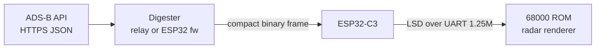

# Summary

**mega_wifi_radar** is a Sega Mega Drive / Genesis ROM (SGDK, C, 68000) that draws a live
ATC-style radar scope: range rings, a rotating sweep, aircraft blips with history trails, and
data tags (callsign, altitude, ground speed). It runs on the owner's **MegaWiFi Rev.C** cartridge
(an ESP32-C3 talking to the 68k over a 16C550 UART at 1.25 Mbaud). Live ADS-B JSON (~40 KB for
25 nm around KORD) is far too big for the console's 64 KiB RAM, so the console receives a
**pre-digested compact binary frame**. This comes either from a relay service (option A) or from
a firmware extension (option B); see [architecture/data-path-options.md](architecture/data-path-options.md).
The rendering layer is built against a fake in-ROM data source so it can be developed in emulators.

**Status (2026-10-28):** design phase. No code exists yet. SGDK pin and data path are under
discussion; see [plans/roadmap.md](plans/roadmap.md).

