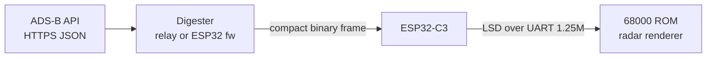

# Summary

**mega_wifi_radar** is a Sega Mega Drive / Genesis ROM (SGDK, C, 68000) that draws a live
ATC-style radar scope: range rings, a rotating sweep, aircraft blips with history trails, and
data tags (callsign, altitude, ground speed). It runs on the **MegaWiFi Rev.C** cartridge (github.com/jfryman/mw-cart)
(an ESP32-C3 talking to the 68k over a 16C550 UART at 1.25 Mbaud). Live ADS-B JSON (~40 KB for
25 nm around KORD) is far too big for the console's 64 KiB RAM, so the console receives a
**pre-digested compact binary frame**. This comes either from a relay service (option A) or from
a firmware extension (option B); see [architecture/data-path-options.md](architecture/data-path-options.md).
The rendering layer is built against a fake in-ROM data source so it can be developed in emulators.

Builds run in a hash-tagged container (m68k-elf gcc 13.2 + SGDK master `9a78a44` patched for
Rev.C); see [build/container-build.md](build/container-build.md). The ROM is the full radar:
a V-Int renderer (thin-line sweep, blips, trails, tags, side panel, Classic/STARS themes) fed once per sweep
from the relay, plus a setup screen (Wi-Fi, home airport, relay, saved to ESP32 flash). The data path is a relay (option A) serving the agreed v1 compact frame
([architecture/frame-format.md](architecture/frame-format.md)); see [plans/roadmap.md](plans/roadmap.md).
The project is public at github.com/jfryman/mega-wifi-radar (MIT). CI builds the cart and emulator ROMs and a multi-arch
relay image, and publishes releases on `v*` tags ([build/ci-release.md](build/ci-release.md)).
Printed extras (cartridge label, clamshell cover, manual) are generated with Typst from shared art and copy
([print/print-assets.md](print/print-assets.md)).

