# Ambient mode (`src/ambient.c`)

Left alone, the radar tours flights by itself: after `settings.ambient`'s idle minutes it picks a flight, opens
its detail pop-up, rides along in cockpit mode, comes back to the radar, waits, and picks another. Any button
hands control back, and that press does nothing else. Meant for a cart left running on a TV; it also keeps the
picture moving (the manual warns about burn-in). Cart only: no relay or contract change.

```mermaid
stateDiagram-v2
  [*] --> OFF
  OFF --> RADAR: idle >= 1 / 5 / 15 min (AMB_PANEL: "NET OK AUTO")
  RADAR --> DETAILS: RADAR_SECS (60) since the last ride (the first: at once); pick() found one
  RADAR --> RADAR: nothing to pick: look again in RETRY_SECS (10)
  DETAILS --> RIDE: DETAILS_SECS (8): AMB_COCKPIT
  RIDE --> RADAR: AMBIENT_RIDE_SECS (75), or the ride failed (ambient_back(FALSE))
  RIDE --> OFF: any button (ambient_back(TRUE))
  RADAR --> OFF: any button (swallowed)
  DETAILS --> OFF: any button (pop-up closed, swallowed)
```



## Picking (`pick`, `score`)
Over the `[main]` side of the track table (`tracks[i].next`, used && !drop), like `tlist_rebuild`. Ground,
stale and unknown-altitude traffic are skipped (poor rides). Highest score wins:
1. emergency (`AR_F_EMERG`): nearest first;
2. airborne within 10 nm of home: **lowest** first (terrain close up makes the best view);
3. anything else airborne: nearest first.
The aircraft of the last ride is only picked again if nothing else qualifies.

## Wiring (`main.c`)
```c
if (swallow || ambient_input(j)) {      /* handle_input: the press that ends ambient mode does nothing else */
    swallow = j != 0; prev = j; panel_net(); return;
}
...
enum ambient_act act = ambient_tick();  /* main loop, every radar frame, after input */
if (act == AMB_PANEL) panel_net();      /* "NET OK AUTO" / "NET OK" */
if (want_cockpit || act == AMB_COCKPIT)
    by_user = cockpit_run(icao, want_cockpit ? 0 : AMBIENT_RIDE_SECS);
```
- **Idle** = frames since `radar_joy()` last read non-zero (any button held or pressed), on the radar. A ride you
  start yourself (Y, or A in the pop-up) ends with B, which counts as activity (`ambient_input(BUTTON_B)` after
  it), so coming back from a long ride doesn't start a tour at once. Setup's START is a press too.
- **Swallow:** after the ending press, input is ignored until every button is up, so a tap of C doesn't open the
  pop-up on release and a held ▲ doesn't scroll.
- **Rides:** `cockpit_run(icao, ride_secs)` (`cockpit.c`): with `ride_secs`, any button or the time ends it, and it
  returns TRUE if a button did. Its HUD shows `LIVE  AUTO` in the status slot (a flyover's `OVERHEAD!` wins) and
  `ANY BUTTON: RADAR` on the back row. A failed ride (no terrain, aircraft not in the feed) returns FALSE at once:
  ambient carries on, and the next pick skips that aircraft.
- **Panel:** `panel_net()` writes `NET OK AUTO` only when the last poll was fine (`net_ok`); error and `STALE`
  texts are shown as they are.
- Notices and the emergency alert keep working; picking closes a notice box (`notice_banner_close(TRUE)`).

## Setting
`settings.ambient` (`enum ambient_mode`: OFF, AFTER 1 / 5 / 15 MIN) is the MWR3 record's first spare byte, so
records saved before it load as OFF ([config-screen.md](config-screen.md)). Setup row AMBIENT, after SOUND.

## Emulator
`make sim`, then set AMBIENT in setup and wait: `SIM_PRESS="18:P1 Start,19:P1 Down,19.4:P1 Down,19.8:P1 Down,
20.2:P1 Down,20.8:P1 Right,21.5:P1 Start"` (AFTER 1 MIN) starts a tour at ~82 s (details), rides at ~90 s.
Verified 2026-11-01: details → ride (DAL768, 75 s, `LIVE  AUTO`) → radar with the aircraft reselected; a C tap
during the details ends it with no pop-up toggle and it starts again a minute later. In the emulator a ride can
fail at once: the fake cockpit recording plays on its own clock and doesn't hold every aircraft in every frame
(`feed_fake.c`); the real relay looks any listed aircraft up.

Related: [cockpit.md](cockpit.md), [traffic-list.md](traffic-list.md), [detail-popup.md](detail-popup.md),
[notices.md](notices.md).
