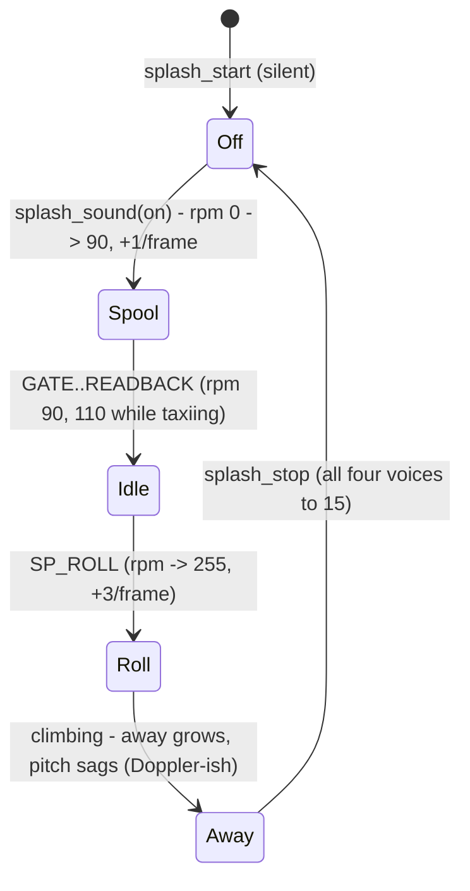

# Boot sound: engines and radio on the PSG (`src/sfx.c`)

The boot splash ([boot-splash.md](boot-splash.md)) has sound: the 787's engines spool up at the gate, idle
through taxi and hold, roar on the takeoff roll and fade as it climbs away. Every radio call opens and
closes with a squelch burst, and a garbled radio "voice" burbles while its letters type, higher for the tower,
lower for the pilot. Engines duck under a transmission. Setup's **SOUND** row (ON/OFF) switches it, together
with the flyover chime ([notices.md](notices.md)).

## Decisions (agreed 2026-11-01)
- **PSG, not FM.** The SN76489's noise channel is jet roar and radio static; the 68000 writes it directly at
  `$C00011`, no Z80 bus request (unlike the YM2612), so it's safe to drive from the splash V-Int while main
  blocks in `mw_*`. SGDK's null Z80 driver never touches the PSG. FM stays the chime's.
- **Squelch + voice blips.** Squelch open (white noise, high rate) when a call starts, a shorter tail when its
  last letter types. A new random pitch every 3rd letter, cut on spaces, so words sound like syllables.
- **SOUND setting = the old CHIME byte.** `settings.sound` (`SOUND_ON` / `SOUND_OFF`), same offset in
  `MWR2`, no migration. Settings load only after the module is detected, so the splash starts silent and
  main calls `splash_sound(on)` once they're known: the engines spool up from then (the first radio-check
  squelch is silent). `splash_start(SP_HOLD)` after setup is followed by another `splash_sound`.

## Channels
| PSG channel | Use |
|---|---|
| tone 0 | turbine whine: divider `240 - rpm*11/16` (~470 Hz idle-off → ~1.7 kHz full) |
| tone 1 | radio voice: tower divider 90..153, pilot 150..213 (random), volume decays 2 steps/frame |
| tone 2 | silent; its divider clocks the noise (`NF = 3`) so the roar's pitch follows rpm (`700 - rpm*2`) |
| noise | engine roar (white, NF 3) or squelch (white, NF 0) while a burst lasts |

Volumes are attenuation (0 loud, 15 off): whine `15 - rpm/32`, roar `15 - rpm*10/256`, each plus `duck`
(3 while a call is up) and `away` (climb height / 16 px, plus the fade-out). The noise mode register is
written only when it changes: rewriting it resets the noise LFSR and clicks.



## Interface (`src/sfx.h`)
```c
void sfx_on(bool on);                  /* silence + reset; on = engines start from rpm 0 */
void sfx_squelch(u8 frames, u8 vol);   /* noise burst over the roar */
void sfx_letter(bool tower, char c);   /* a typed letter: maybe a new voice syllable */
void sfx_tick(u8 rpm, u8 pitch_rpm, u8 duck, u8 away);  /* V-Int, once per frame: write the PSG */
```
The splash owns the rpm model (phase → target, ramp) and calls these from its V-Int; `sfx_*` never divides
or multiplies in 32 bits (V-Int rule, [radar-renderer.md](radar-renderer.md)).

## Lessons
- The voice can only be judged by ear on the cart: MAME's `SIM_WAV` proves it isn't silent, not that it's nice.
- MAME's PSG output in the WAV sits on a DC offset: subtract each window's mean before counting zero crossings,
  or every engine stretch reads as silence (0 crossings).

Related: [boot-splash.md](boot-splash.md), [notices.md](notices.md) (FM chime, Z80-bus lesson), [config-screen.md](config-screen.md).
