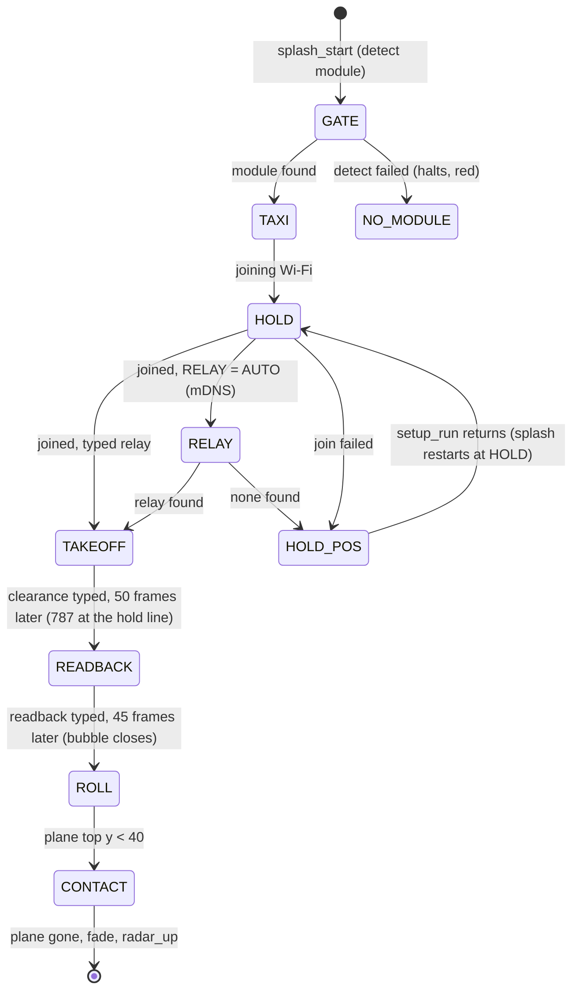
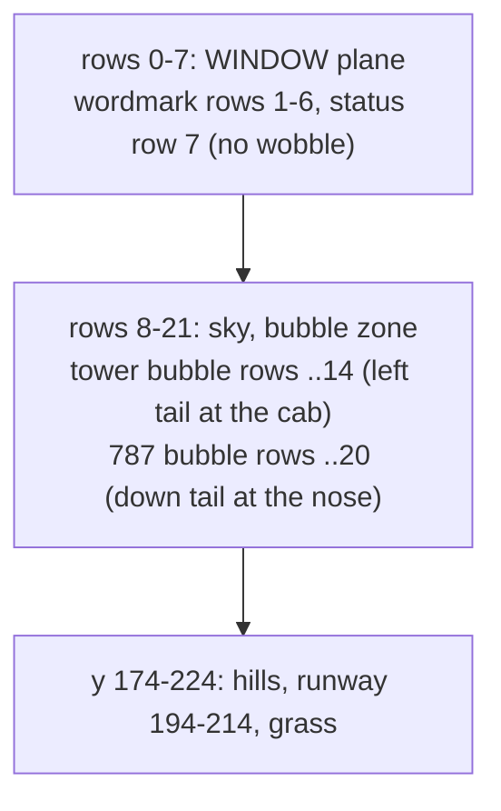

# Boot splash: 787 departure driven by the real boot (`src/splash.c`)

The boot is a dawn airport scene. Our **MEGA WIFI RADAR** wordmark sits across the top
with a Sega-style shine, a control tower stands on the left, and a **787** taxis right, holds short,
and takes off behind the logo. Each radio call is a real boot step, spoken in a **ToeJam & Earl-style
speech bubble** that points at whoever is talking (tower cab or 787), with letters bobbing in a wave.
No Sega marks are used (see [../practices.md](../practices.md)).



## Decisions
- Logo: our wordmark in the Sega-splash style, never the SEGA logo. Aircraft: a 787 Dreamliner (smooth nose,
  raked wingtips, chevron nacelles), in a generic white livery with a navy tail and our red stripe.
- **Driven by boot:** `main.c` calls `splash_phase()` at each step. Each phase shows for at least ~1.5 s
  so its call can be read. START skips the minimums and the rest of the animation.
- Callsign **MEGA 787**, departing east on **runway 9** (side view, moving right). The ground/tower
  callsign uses the first word of the home airport's name (`NASHVILLE GROUND`).
- **Speech bubbles (agreed 2026-11-01):** one bubble at a time; it opens as a call starts and the next call
  replaces it. The bubble's position says who speaks, so all call text is navy; failure details stay red.
  The pilot reads the takeoff clearance back **at the hold line**, before rolling (realistic, and the tail
  still points at the plane). The bubble closes when the roll starts; RADAR CONTACT comes from the tower.
- **Letter wave:** plane A uses 2-cell column vertical scroll; a travelling sine of ±2 px bobs the text
  two characters at a time. The bubble body sits still on plane B.
- Status line (window row 7, dim, under the wordmark): version + firmware + settings, then `IP a.b.c.d  RELAY host:port`.

## Scene and layers

| Layer | Content | Palette |
|---|---|---|
| Window (rows 0–7, high priority) | wordmark rows 1–6; status row 7 | PAL1 logo, PAL3 text |
| Plane A (high priority) | bubble text only; column vscroll wave | PAL1 navy, PAL2 red |
| Plane B | scene (sky dither, hills, runway, tower); bubble body tiles (high priority) written over it, restored from `splash_bg_map` on close | PAL0 scene, PAL3 bubble |
| Sprites (low priority) | 787: 96×48 px = 3×2 sprites of 4×3 tiles; 4 frames (0°, 6°, 12° gear down, 18° gear up) | PAL2 |

Low-priority sprites sit under high-priority window and plane B tiles, so the climbing 787 passes **behind**
the wordmark and behind the RADAR CONTACT bubble. The window plane is what keeps the wordmark and status
still: column vscroll applies to every plane A column top to bottom, the window never scrolls.

The shine is palette cycling: the generator re-indexes the wordmark body into **12 diagonal band slots spread
once across its width** (PAL1 3..14, `(x - y/2 + 24) * 12 / 312`). A white highlight with light-blue
neighbours walks through them every ~3 s. Repeating slots (every 48 px) would read as stripes, not a glint.

## Bubbles
Text wraps at word boundaries to `BUB_TW` = 26 columns, up to `BUB_LINES` = 4 lines; a red detail starts on a
new line. The bubble is `longest line + 2` cells wide and `lines + 2` rows high; border tiles draw their line
in the outer pixels so the ±2 px bob stays inside the white.

| Speaker | Anchor | Tail |
|---|---|---|
| Tower | left edge col 8, bottom row 14, grows up | left-pointing tip at col 7 on the bottom text row (cab windows y 105–113) |
| 787 | bottom row 20, grows up; centred on the nose column, clamped to cols 1..38 | down-pointing tip on row 21, at the cockpit column (`px + NOSE_DX`, 86) when the call opens |

13 bubble tiles come from art page 7 (PAL3: 1 navy outline, 2 white fill): 9 for corners/edges/fill, plus
left gap + tip and bottom gap + tip. Tiles at fixed coordinates in the page, see `tools/splashgen`.

```c
/* V-Int, every frame: 20 columns x (plane A, plane B) words into VSRAM */
*(vu32 *)VDP_CTRL_PORT = VDP_WRITE_VSRAM_ADDR(0);
for (u16 c = 0; c < 20; c++) { *(vu16 *)VDP_DATA_PORT = wave[(c * 3 + (ticks >> 2)) & 15]; *(vu16 *)VDP_DATA_PORT = 0; }
```
`splash_stop` puts the VDP back: `VSCROLL_PLANE`, VSRAM zero, window off and cleared. Nothing else in the ROM
sets the scroll mode except cockpit mode, so a leftover column mode would wobble the radar.

## Art pipeline
`res/splash/src/art.typ` (Typst vectors, same fonts as print) → `make splash-art` renders PNGs at 72 ppi
(1 pt = 1 px) into `out/splash/` → `tools/splashgen` (stdlib Go) quantizes each image to its palette from
`res/splash/src/palettes.json` (Genesis levels 0..7; exact colours kept, gradients above the horizon (`skyRows`)
Bayer-dithered over sky indices 1..7), dedupes tiles, and writes `res/splash/*.bin` + `src/splash_data.h`
(committed, like `res/scope`). Pages: 1 scene, 2 wordmark, 3–6 the 787, 7 bubble tiles.
Sprite tiles are column-major per 4×3 sprite (VDP order).

## API (`src/splash.h`)
```c
splash_start(SP_GATE);                 /* scene up, V-Int animating; main must not touch the VDP */
splash_phase(SP_TAXI, NULL);           /* waits: call typed, >= DWELL frames up, >= LINGER since typed (START skips) */
splash_status("v0.2.0  FW 1.5 ...");   /* dim row 7 */
splash_phase(SP_HOLD_POS, "WI-FI FAILED: OPENING SETUP");  /* then splash_stop(); setup_run(); splash_start(SP_HOLD) */
splash_phase(SP_TAKEOFF, NULL); splash_finish();           /* readback, departure, RADAR CONTACT, fade, stop */
```
SP_READBACK, SP_ROLL and SP_CONTACT are internal: the V-Int switches to them from timing and the plane's
position (`switch_phase`, no interrupt toggling). Calls from main go through `set_phase` with interrupts off,
because both sides write the VDP. The bubble text is redrawn from `(lines, typed)` every frame, so it's pure
state; the bubble body is drawn once per call. The emulator build (`FAKE_FEED`) runs the same phases with
dwell-only waits, and its status line carries no version (its shots go into the manual).

## Motion (sprite top-left, 60 Hz)
Gate x=20 → taxi at 0.5 px/frame to the hold line x=103 (nose short of the bars at x=200), wheels on the
centre line at `GROUND_Y` 161 → **holds through the clearance and the readback** → roll accelerating to
3 px/frame → frame 1 at x=135 → from x=150 climb: vx eases to 2 px/frame, vy ramps to -vx (45° path) →
frame 2 at x=150, frame 3 gear up at x=170 → vy ramps to -1.5·vx (~56°) → off the top right, behind the
wordmark. The path is far steeper than the 18° sprite pitch on purpose: with the ground at the bottom and the
wordmark at the top, a 45° path leaves through the right edge; a realistic 15° one never leaves the sky.

## Lessons
- Every call is built in a 64-byte buffer; an over-long `sprintf` into a small stack buffer once smashed the
  return address (address error, PC outside ROM). The wrapper cuts at `BUB_LINES`.
- Snapshots taken at regular intervals can line up with phase starts and make typing look stuck. Offset the times
  or add a debug row (`phase typed len len skip`) before chasing a phantom bug.
- Each palette's index 15 is the SGDK font colour, so text colours live there: navy call text PAL1,
  failure red PAL2, status grey PAL3.
- Column vscroll moves whole plane A columns. Anything that must not wobble lives in the window or plane B.
- A call's linger counts from its **last letter** (`typed_at`), not from the phase start: a long call types for
  longer than a short minimum, so "frames since phase start" closed it the moment it finished typing.
  `call_done(min, linger)` checks both; main's waits use `DWELL` 90 and `LINGER` 40.

Related: [radar-renderer.md](radar-renderer.md) (same V-Int ownership rules), [config-screen.md](config-screen.md).
