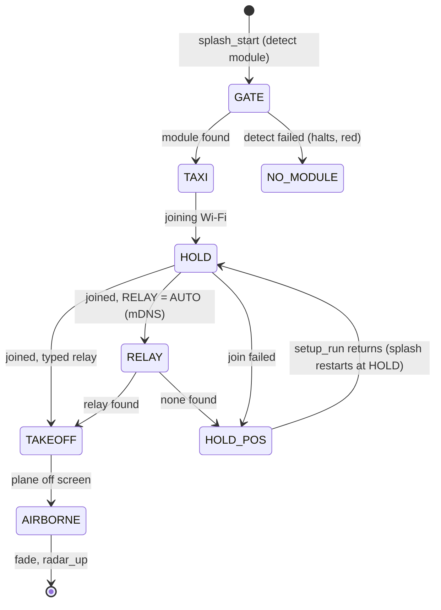

# Boot splash: 787 departure driven by the real boot (`src/splash.c`)

The boot is a dawn airport scene. Our **MEGA WIFI RADAR** wordmark sits in the
centre with a Sega-style shine, a control tower stands on the left, and a **787** taxis right, holds
short, and takes off behind the logo. Each ATC call is a real boot step, so the animation shows what
boot is actually doing. No Sega marks are used (see [../practices.md](../practices.md)).



## Decisions (agreed 2026-10-28)
- Logo: our wordmark in the Sega-splash style, never the SEGA logo. Aircraft: a 787 Dreamliner (smooth nose,
  raked wingtips, chevron nacelles), in a generic white livery with a navy tail and our red stripe.
- **Driven by boot:** `main.c` calls `splash_phase()` at each step. Each phase shows for at least ~1.5 s
  so its call can be read. START skips the minimums and the rest of the animation.
- Callsign **MEGA 787**, departing east on **runway 9** (side view, moving right). The ground/tower
  callsign uses the first word of the home airport's name (`NASHVILLE GROUND`).
- Status line (row 26, dim): version + firmware + settings, then `IP a.b.c.d  RELAY host:port`.
- SP_RELAY (pilot): *Tower, MEGA 787, holding short, request radar service.* The plane stays at the hold line.

## Scene and layers
| Layer | Content | Palette |
|---|---|---|
| Plane B | sky gradient (ordered dither), horizon, runway with centre-line dashes, tower | PAL0 |
| Plane A (high priority) | wordmark at y≈64–112; ATC text box rows 22–26; status row 27 | PAL1 logo, PAL3 text |
| Sprites (low priority) | 787: 96×48 px = 3×2 sprites of 4×3 tiles; 4 frames (0°, 6°, 12° gear down, 18° gear up) | PAL2 |

Low-priority sprites under high-priority plane A make the climbing 787 pass **behind** the wordmark.
The shine is palette cycling: the generator re-indexes the wordmark body into **12 diagonal band slots spread
once across its width** (PAL1 3..14, `(x - y/2 + 24) * 12 / 312`). A white highlight with light-blue
neighbours walks through them every ~3 s. Repeating slots (every 48 px) would read as stripes, not a glint.

## Art pipeline
`res/splash/src/art.typ` (Typst vectors, same fonts as print) → `make splash-art` renders PNGs at 72 ppi
(1 pt = 1 px) into `out/splash/` → `tools/splashgen` (stdlib Go) quantizes each image to its palette from
`res/splash/src/palettes.json` (Genesis levels 0..7; exact colours kept, gradients above the horizon Bayer-dithered
over sky indices 1..7), dedupes tiles, and writes `res/splash/*.bin` + `src/splash_data.h` (committed, like `res/scope`).
Sizes now: scene 113 tiles, wordmark 170, 787 4×72. Sprite tiles are column-major per 4×3 sprite (VDP order).

## API (`src/splash.h`)
```c
splash_start(SP_GATE);                 /* scene up, V-Int animating; main must not touch the VDP */
splash_phase(SP_TAXI, NULL);           /* waits: current call fully typed and >= DWELL frames (START skips) */
splash_status("v0.1.2  FW 1.5 ...");   /* dim row 26 */
splash_phase(SP_HOLD_POS, "WI-FI FAILED: OPENING SETUP");  /* then splash_stop(); setup_run(); splash_start(SP_HOLD) */
splash_phase(SP_TAKEOFF, NULL); splash_finish();           /* departure, RADAR CONTACT, fade, stop */
```
SP_ROLL and SP_CONTACT are internal: the V-Int switches to them from the plane's position (`switch_phase`, no
interrupt toggling). Calls from main go through `set_phase` with interrupts off, because both sides write the VDP.
The radio box is redrawn from `(lines, typed)` every frame, so it's pure state. The emulator build (`FAKE_FEED`) runs
the same phases with dwell-only waits, and its status line carries no version (its shots go into the manual).

## Motion (sprite top-left, 60 Hz)
Gate x=20 → taxi at 0.5 px/frame to the hold line x=103 (nose short of the bars at x=200) → **holds until
the takeoff clearance is fully typed** → roll accelerating to 3 px/frame → frame 1 at x=135 (readback call) →
from x=150 climb: vx eases to 2 px/frame, vy ramps to -vx (45° path) → frame 2 at x=150, frame 3 gear up at x=170 →
passes behind "RADAR" → off the top right (RADAR CONTACT call once y < 40). The path is steeper than the 18° sprite
pitch on purpose: a realistic 15° climb would leave the screen below the wordmark.

## Lessons
- Every radio line must fit 38 columns, city included (≤ 9 chars). An over-long `sprintf` into the stack buffer
  smashed the return address (address error, PC outside ROM). `script()` now formats into 64 bytes and `say()` truncates.
- Snapshots taken at regular intervals can line up with phase starts and make typing look stuck. Offset the times
  or add a debug row (`phase typed len len skip`) before chasing a phantom bug.
- A realistic ~15° climb leaves the screen below the wordmark. The path is 45° on purpose (sprite pitch 18°).
- Each palette's index 15 is the SGDK font colour, so the four text colours live there: pilot white PAL0, ATC cyan
  PAL1, failure red PAL2, status grey PAL3.

Related: [radar-renderer.md](radar-renderer.md) (same V-Int ownership rules), [config-screen.md](config-screen.md).
