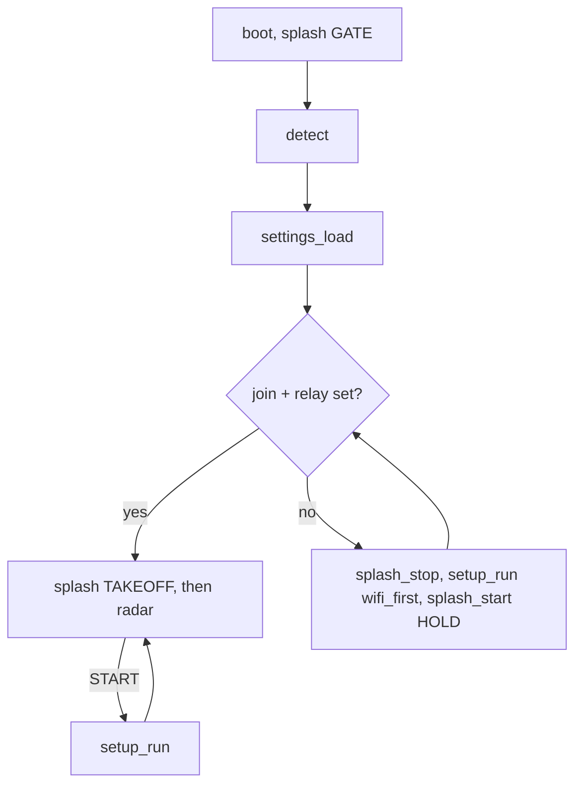

# Setup screen (src/setup.c, keyboard.c, ui.c, settings.c)

Opened with **START** on the radar, by **holding START at boot**, or automatically when Wi-Fi
can't join or no relay is found. The cursor starts on RELAY when the relay is AUTO and none was found. Runs with the renderer stopped (SGDK's normal VBlank loop).

| Row | Control |
|---|---|
| THEME | L/R: CLASSIC, STARS, AMBER, NIGHT, MARINE, ICE, POCKET, SUNSET, ERAM ([screen-layout.md](screen-layout.md)) |
| RANGE | L/R: 5 / 10 / 25 / 50 / 100 nm |
| TAGS | L/R: ALL / SELECTED / OFF |
| WEATHER | L/R: ON / OFF, the weather overlay ([weather.md](weather.md)); Z on the radar too |
| MAP | L/R: ON / OFF, the video map ([video-maps.md](video-maps.md)) |
| SOUND | L/R: ON / OFF, the boot sound ([boot-sound.md](boot-sound.md)) and the flyover notice chime ([notices.md](notices.md)); switching to ON plays the chime (`ui_pad` ticks it) |
| AMBIENT | L/R: OFF / AFTER 1, 5, 15 MIN ([ambient.md](ambient.md)) |
| AIRPORT | L/R step, C next letter, A type an ICAO code; 1,143 airports (`src/airports.c`) |
| WI-FI | A: scan (`net_scan`), pick, keyboard password, `net_connect` (slot 0, DHCP, saved) |
| RELAY | `AUTO <found host>` or `AUTO (MDNS)` when empty (mDNS, [../net/discovery.md](../net/discovery.md)); A: keyboard edit (empty = AUTO); C: back to AUTO |
| GUIDE | A: four read-only pages on what's on the radar (`guide_page`): tags and blips, weather, video map + reading an approach, side panel; L/R or A page, B/START back |
| CONTROLS | A: read-only page of the radar + setup buttons (`controls_page`; descriptions from col 14, ≤ 25 chars); A/B/START back |
| RESET | A: page with WI-FI / SETTINGS / EVERYTHING / CANCEL; A twice confirms, then the console hard-resets |
| SAVE & EXIT / EXIT | START = save |

- **Reset** (for testing first-boot flows): WI-FI = `mw_ap_disassoc()` then `mw_factory_settings()` (the firmware only
  accepts FACTORY_RESET in the idle state, so a joined module rejects it; this clears the module's config: AP slots, IP config,
  default slot; our user_data is untouched); SETTINGS = erase the settings sector (back to defaults on the next boot);
  EVERYTHING = both. Every reset also writes the **dev-defaults-off marker** (`"MWRN"` + the ROM header checksum at
  `$18E`, user_data sector 1). While it matches the running ROM, boot skips `net_ensure_ap(DEV_WIFI_*)` and the
  `DEV_RELAY_URL` default, so a dev build really shows "Wi-Fi not set" / AUTO relay. Flashing any other build changes
  the checksum and the dev defaults come back. Then `SYS_hardReset()`.
- Keyboard: 7 rows of 13 chars + SPACE/DEL/OK/CANCEL; A type, B delete, START OK.
- `ui_wait_release()` on entry: the press that opened a screen must not act on it.
- Persistence: `settings_save()` writes `"MWR3" + struct settings + checksum` to ESP32 user_data
  sector 0 (`mw_flash_sector_erase/write`); `settings_load()` at boot. Defaults come from devcfg.
  Older records are upgraded on load, so updating loses nothing: `"MWR2"` (0.4.0-0.4.1, `struct saved_v2`: no
  `sort`, loaded as NEAREST) and `"MWR1"` (0.3.x, `struct saved_v1`: no `sound` either, loaded ON). New fields
  start zeroed (`memset` before the copy), so **0 must be every new field's default**. `_Static_assert`s keep the
  old fields first and unchanged.
- **Spare bytes:** the record had 7; `ambient` took the first, `wx` the second (0 = ON), `map` the third (0 = ON), `rsv[4]` are left, saved as 0 and not validated.
  The next small setting takes one (0 = its default) without a new magic; older builds keep them as they found
  them. A field whose 0 can't be the
  default, or more than 7 bytes, still needs `MWR4` and a migration.
- **Saving from the radar:** zoom (A/B), tags (◀▶), theme (X), weather (Z) and the sort order (hold C) call
  `settings_changed()`; the radar's `poll()` writes the record when `settings_save_due()` (dirty, and 30 s since
  the last radar save), right after the frame and notice requests: a blocking flash write in the poll's blocking
  slot, never from the input handler. A failed write isn't retried until the next change.
- `src/airports.c` is generated: `cd tools && go run ./airportgen -o ../src/airports.c` (OurAirports, public domain).
- Layout: title on row 1; `row_y[]`: settings in single-spaced blocks: the scope (THEME 3, RANGE 4, TAGS 5, WEATHER
  6, MAP 7), SOUND 9 + AMBIENT 10, AIRPORT 12 (its name on 13), WI-FI 15 + RELAY 16; the four actions CONTROLS 21,
  RESET 22, SAVE & EXIT 23, EXIT 24; status on row 25, one hint line on row 26 (`L/R CHANGE  A EDIT  C JUMP  START
  SAVE`); GUIDE 20 heads the actions block (GUIDE 20, CONTROLS 21 ...). Rows 17-19 are free. `print/shots.txt`'s `keyboard` shot counts Downs to RELAY (9) and the manual's setup
  callouts follow the rows.
- CONTROLS page: the radar block includes Z (WEATHER ON/OFF); the last line sits on row 25.
- **GUIDE pages** (`setup.c`, owner's ask 2026-11-02: "this sort of detail is helpful" in game too): `g_pages[]` of rows
  `{ pal, left, right }`: left from col 2 (≤ 12 chars), right from col 15 (≤ 24: col 38 is the last safe one; the font
  has no `~` or `<`). `pal` is a text palette, so samples use the **theme's own** colours (LOW/MID/HIGH/EMERGENCY,
  the weather and map colours). `G_TILE` rows draw 3 cells of a sample tile at cols 2-4 (`right[0]` = '0' + index:
  0-2 `radar_wx_tiles`, 3 runway bar, 4 dashed centreline, loaded at `TILE_USER_INDEX`, which `radar_init` reloads),
  label from col 6 (≤ 8), text from `right + 3`. ROM only: no RAM (the heap has 267 B to spare). Keep the text in
  step with the manual's Scope and Video Map pages.
- SGDK quirks: `strncpy` doesn't zero-pad. `sprintf` left-justifies (`%-8s`, `%-*s` work: panel, pop-up); don't
  rely on `%.Ns` precision.


```c
struct settings {               /* src/settings.h; saved as "MWR3" + struct + checksum */
    u8 theme, range_idx, tag_mode;
    char icao[5];
    s32 lat_e4, lon_e4;
    char relay[RELAY_LEN + 1];  /* "" = AUTO (mDNS) */
    u8 sound;                   /* SOUND_ON / SOUND_OFF (was CHIME: same byte, same values) */
    u8 sort;                    /* traffic list order (enum sort_mode); MWR3 on */
    u8 ambient;                 /* enum ambient_mode: 0 OFF (ambient.md) */
    u8 wx;                      /* enum wx_mode: 0 ON (weather.md) */
    u8 map;                     /* enum map_mode: 0 ON (video-maps.md) */
    u8 rsv[4];                  /* spare, 0 */
};
```

Related: [radar-renderer.md](radar-renderer.md), [../net/net-layer.md](../net/net-layer.md).
