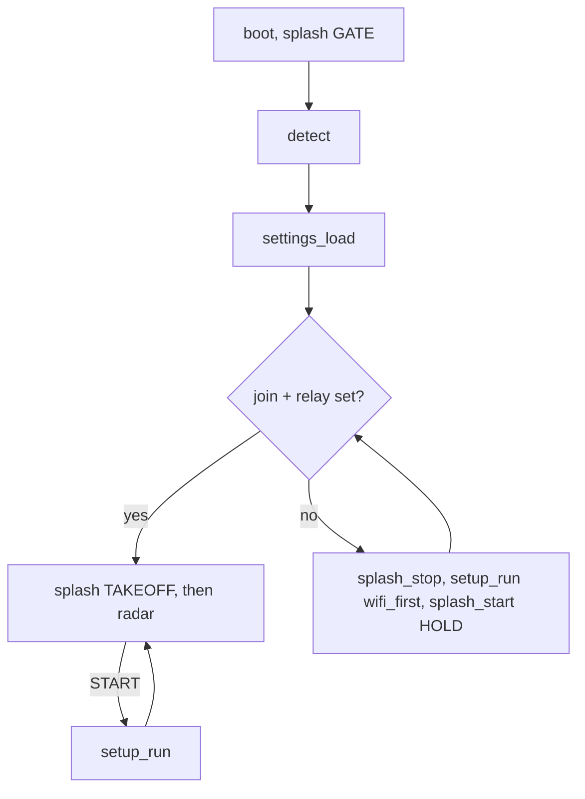

# Setup screen (src/setup.c, keyboard.c, ui.c, settings.c)

Opened with **START** on the radar, by **holding START at boot**, or automatically when Wi-Fi
can't join or no relay is found. The cursor starts on RELAY when the relay is AUTO and none was found. Runs with the renderer stopped (SGDK's normal VBlank loop).

| Row | Control |
|---|---|
| THEME | L/R: CLASSIC / STARS |
| RANGE | L/R: 5 / 10 / 25 / 50 / 100 nm |
| TAGS | L/R: ALL / SELECTED / OFF |
| AIRPORT | L/R step, C next letter, A type an ICAO code; 1,143 airports (`src/airports.c`) |
| WI-FI | A: scan (`net_scan`), pick, keyboard password, `net_connect` (slot 0, DHCP, saved) |
| RELAY | `AUTO <found host>` or `AUTO (MDNS)` when empty (mDNS, [../net/discovery.md](../net/discovery.md)); A: keyboard edit (empty = AUTO); C: back to AUTO |
| CONTROLS | A: read-only page of the radar + setup buttons (`controls_page`; descriptions from col 14, ≤ 25 chars); A/B/START back |
| RESET | A: page with WI-FI / SETTINGS / EVERYTHING / CANCEL; A twice confirms, then the console hard-resets |
| SAVE & EXIT / EXIT | START = save |

- **Reset** (for testing first-boot flows): WI-FI = `mw_ap_disassoc()` then `mw_factory_settings()` (the firmware only
  accepts FACTORY_RESET in the idle state, so a joined module rejects it; this clears the module's config: AP slots, IP config,
  default slot; our user_data is untouched); SETTINGS = erase the `MWR1` sector (back to defaults on the next boot);
  EVERYTHING = both. Every reset also writes the **dev-defaults-off marker** (`"MWRN"` + the ROM header checksum at
  `$18E`, user_data sector 1). While it matches the running ROM, boot skips `net_ensure_ap(DEV_WIFI_*)` and the
  `DEV_RELAY_URL` default, so a dev build really shows "Wi-Fi not set" / AUTO relay. Flashing any other build changes
  the checksum and the dev defaults come back. Then `SYS_hardReset()`.
- Keyboard: 7 rows of 13 chars + SPACE/DEL/OK/CANCEL; A type, B delete, START OK.
- `ui_wait_release()` on entry: the press that opened a screen must not act on it.
- Persistence: `settings_save()` writes `"MWR1" + struct settings + checksum` to ESP32 user_data
  sector 0 (`mw_flash_sector_erase/write`); `settings_load()` at boot. Defaults come from devcfg.
- `src/airports.c` is generated: `cd tools && go run ./airportgen -o ../src/airports.c` (OurAirports, public domain).
- Layout: title on row 1, `ROW_Y(r) = 3 + 2r + (r > R_AIRPORT)` (the airport name gets a line), EXIT on row 22,
  hints on rows 23–24, status on row 25.
- SGDK quirks: `strncpy` doesn't zero-pad. `sprintf` left-justifies (`%-8s`, `%-*s` work: panel, pop-up); don't
  rely on `%.Ns` precision.


```c
struct settings {               /* src/settings.h; saved as "MWR1" + struct + checksum */
    u8 theme, range_idx, tag_mode;
    char icao[5];
    s32 lat_e4, lon_e4;
    char relay[RELAY_LEN + 1];  /* "" = AUTO (mDNS) */
};
```

Related: [radar-renderer.md](radar-renderer.md), [../net/net-layer.md](../net/net-layer.md).
