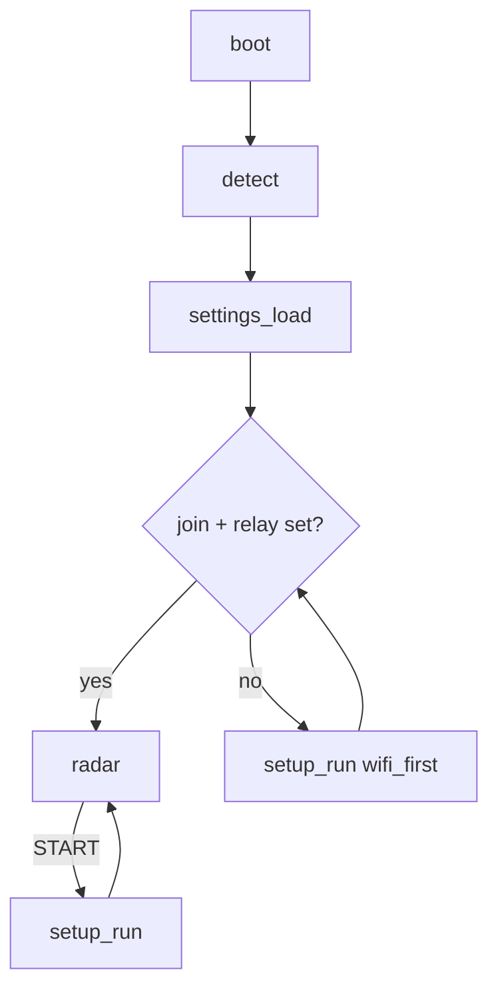

# Setup screen (src/setup.c, keyboard.c, ui.c, settings.c)

Opened with **START** on the radar, by **holding START at boot**, or automatically when Wi-Fi
can't join / no relay is set. Runs with the renderer stopped (SGDK's normal VBlank loop).

| Row | Control |
|---|---|
| THEME | L/R: CLASSIC / STARS |
| RANGE | L/R: 5 / 10 / 25 / 50 / 100 nm |
| TAGS | L/R: ALL / SELECTED / OFF |
| AIRPORT | L/R step, C next letter, A type an ICAO code; 1,143 airports (`src/airports.c`) |
| WI-FI | A: scan (`net_scan`), pick, keyboard password, `net_connect` (slot 0, DHCP, saved) |
| RELAY | A: keyboard edit of the base URL (`http://host:port`) |
| SAVE & EXIT / EXIT | START = save |

- Keyboard: 7 rows of 13 chars + SPACE/DEL/OK/CANCEL; A type, B delete, START OK.
- `ui_wait_release()` on entry: the press that opened a screen must not act on it.
- Persistence: `settings_save()` writes `"MWR1" + struct settings + checksum` to ESP32 user_data
  sector 0 (`mw_flash_sector_erase/write`); `settings_load()` at boot. Defaults come from devcfg.
- `src/airports.c` is generated: `cd tools && go run ./airportgen -o ../src/airports.c` (OurAirports, public domain).
- SGDK quirks: `strncpy` doesn't zero-pad; `sprintf` lacks `%-Ns`/`%.Ns`; pad by hand.

Related: [radar-renderer.md](radar-renderer.md), [../net/net-layer.md](../net/net-layer.md).
