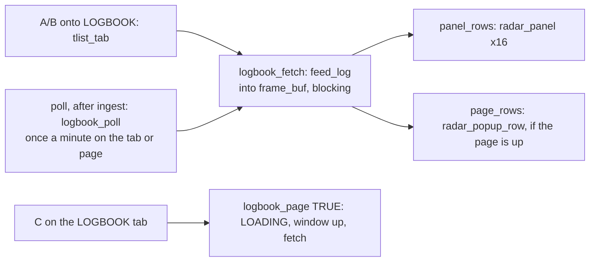

# Logbook on the cart (`src/logbook.c`)

The LOGBOOK tab ([traffic-list.md](traffic-list.md)) and the full logbook page. The relay keeps the log
([../relay/logbook.md](../relay/logbook.md)); the cart only fetches today's summary (`/v1/log`, 192 B) and writes
text. Owner's decisions 2026-11-02: tabs, logbook as a tab, the relay logs all the time into SQLite, the day ends at
the airport's midnight.



## RAM: none kept
The heap had 267 B to spare (148 B after this module), so the body is fetched into **`frame_buf`** (free once the frame is ingested; the next
`feed_fetch` overwrites it) and turned into panel / pop-up text at once: those rows are already static buffers
(`panel_text`, `popup_text`). `have` says the panel rows hold the log; drawing a list tab or `radar_up` forgets it,
and `logbook_panel` shows LOADING until the next fetch. A failed fetch shows NO LOG.

## Panel (11 cols, rows 7-22)
```
28 OCT KBNA     PAL2   day, month, settings.icao
31 AC
18 TYPES
PEAK 12H 31     PAL1   busiest local hour + count; or SINCE 13:05 when logging began after midnight
FASTEST KT      PAL1   heads carry the units, so the rows read like the list's: cs (7) + space + 3 digits
JIA5446 502
HIGHEST FL
AAY935  380
LONGEST MIN
AAL588    1
RARE 2          PAL1   or NO RARES
SWA4720  C17    up to 4, newest first; military PAL2
G26622   H60
C: FULL LOG     PAL1
```

## Page (pop-up window rows, 28 cols)
Title `TODAY AT KBNA  28 OCT`, AIRCRAFT n, m TYPES; BUSIEST hh:00, n NEW; LOGGED FROM MIDNIGHT|hh:mm; RECORDS (label 8,
cs 8, type 5, value: `502KT`, `FL380`, `2H10`/`1M`); RARE TODAY: `hh:mm  CS  TYPE  MIL|FLAG|TYPE` (≤ 8); a footer.
It shares the window with the detail pop-up: `popup_open` closes it and `logbook_page(TRUE)` closes the pop-up.
While it's up: B (or C) closes it, A does nothing, ◀▶ don't zoom, notices wait (`notice_radar_tick`); cockpit
entry and setup close it.

## Controls (0.5.0 remap, [screen-layout.md](screen-layout.md))
◀▶ zoom (right in), A/B tabs, C details / logbook page, hold C nothing, tags only in setup.

## Emulator
`res/fake/log.bin` (`make fake-feed`: `relay -pack-log`): the KBNA recording replayed into an in-memory logbook, one
B38M turned into a C-17 so a TYPE rare shows beside the recording's own military UH-60. Shots `logbook`, `logpage`.

Related: [../relay/logbook.md](../relay/logbook.md), [notices.md](notices.md), [detail-popup.md](detail-popup.md).
