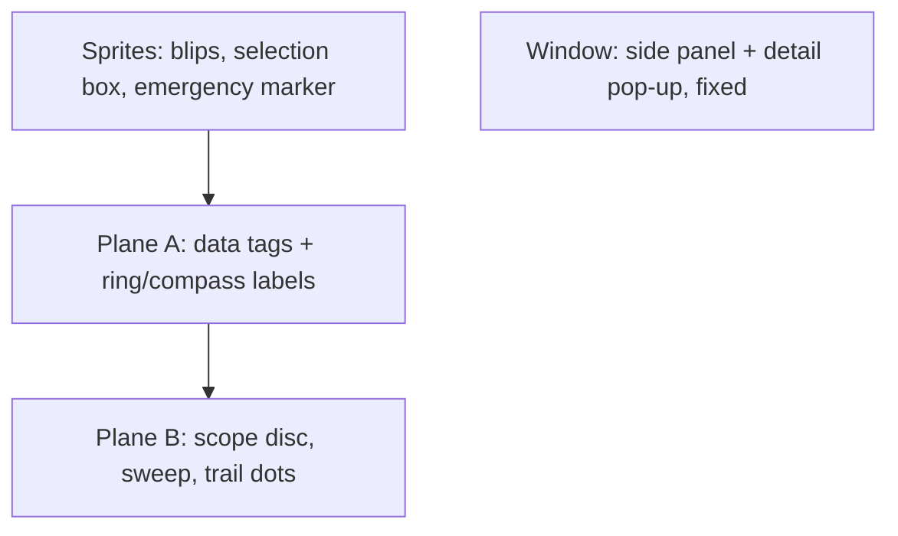

# Radar screen layout

320×224 (H40), 40×28 tiles. Everything that matters stays **≥ 8 px inside the frame**: the owner's
TV crops the bottom text row and the right edge (measured on the spike). Usable area: rows 1–26, cols 1–38.

```
 col 0 1                        2 2 2        3       3 3
     0 1                        6 7 8        5       8 9
row 0  ·· overscan margin ··························· ··
row 1   ·        .----N----.        │ KBNA          │
        ·     .-'  ·  25  · '-.     │ RNG  25NM     │
        ·   .'  ·  20 ·  ·    '.    │ 17:42:05Z     │
        ·  /  · 15 ·  ·  ·     \    │ 28 AC         │
        · |  · 10 · ┌SWA271┐  · |   │ NET OK        │
row 6   · | ·  5 ·  │016 174│  · |  │ - NEAREST -   │  traffic list header
row 7   · W ·  ·  · +◆  ·  ·  ·  E  │ UAL2414 0.5   │  15 rows (lode: traffic-list.md)
        · |  ·  ·  :·  · ┌DAL1046┐  │ SWA271  1.8   │  selected: cyan
        ·  \  ·  ·  ·  · │350 472│  │ ...           │
row 22  ·   '.  ·  ·  ·  ◆·:· .'    │ v13 MORE      │
row 23  ·     '-.  ·  ·  .-'        │ -----------   │
row 24  ·        '----S----'        │ CLASSIC ALL   │  theme + tag mode
row 25                              │ Data:         │
row 26                              │ adsb.fi       │  required, always visible
row 27  ·· overscan margin ·········│···············│
```

## Regions
- **Scope:** disc radius **104 px**, centre **(112, 112)**, in a 208×208 block at pixel (8, 8)
  (tiles 1–26). Home (`+`) at the centre. **5 range rings**, evenly spaced. The art never changes;
  zoom only relabels them (25 nm → 5/10/15/20/25). Compass N/E/S/W at the rim; ring labels along the NE diagonal.
- **Side panel:** cols 28–38 (x 224–311), rows 1–26, on the **window** plane. From the top: airport,
  range, UTC time (SNTP), aircraft count, network state (`NET OK` / `STALE 12s` / `ERR HTTP` / `RELAY VER?`),
  then the [traffic list](traffic-list.md) (header, 15 rows, "more" row), a rule, theme + tag mode, and
  **`Data: adsb.fi`**, which is required and always visible. Each row has its own text palette.
- **Detail pop-up:** window cols 0–27 over the scope while it's open ([detail-popup.md](detail-popup.md)).

## Layers
| Layer | Contents | Notes |
|---|---|---|
| Plane B | scope disc: rings/ticks + **thin-line sweep** with afterglow | 568 unique tiles, RAM copy, see [sweep.md](sweep.md) |
| Plane A | data tags (tile-aligned text) + **trail dots** in a pool of dynamic tiles | one tile per cell: a tag hides trail dots under it |
| Window | side panel; the detail pop-up over cols 0–27 while open | fixed: the scope never scrolls |
| Sprites | one 8×8 blip per aircraft (4 brightness tiles), selection box, emergency marker | ≤ 80 total, ≤ 20 per line |

## Scaling
Records are in 1/32 nm. Screen offset `px = (pos × K) >> 16`, with `K = 104 · 65536 / (range_nm · 32)`.
That's one `MULS` (16×16 → 32) per axis, with no software maths. Ranges: **5 / 10 / 25 / 50 / 100 nm** (A/B).

## Behaviour
- **Trails:** the last **5** positions per aircraft, one sampled per sweep rotation (~21 s of history), dimmer with age.
- **Updates follow the sweep:** a new frame's position for an aircraft is applied when the sweep crosses
  its bearing, and its blip brightness tracks time since that crossing. **One poll per rotation**, fired as the
  sweep passes north. This hides network latency.
- **Tags:** 2 lines (`SWA271` / `016 174`: alt in hundreds of ft, gs kt), coloured by altitude band.
  Placed in the first free spot of 4 candidates around the blip. ◀/▶ cycle *all / selected / off*.
- **Controls:**

  | Button | Action |
  |---|---|
  | A / B | zoom in / out (off while the pop-up is open; B closes it) |
  | ▲ / ▼ | previous / next aircraft in the traffic list (auto-repeat: 16 frames, then every 5) |
  | ◀ / ▶ | tags: all / selected / off |
  | C tap | detail pop-up open / close (acts on release) |
  | C hold (40 frames) | next sort order: NEAREST, A-Z, Z-A, LOW ALT, HIGH ALT |
  | X (6-button) | next theme; a shortcut only (Y, Z unused) |
  | START | setup |

  A 3-button pad must reach everything: 6-button buttons only duplicate setup options. There is no pan:
  the scope is fixed on the home airport (it scrolled the planes but helped nobody, so 0.2.0 removed it).



## Themes (config option)
A theme is data: four palettes plus a few flags. Switching one reloads the palettes and toggles features,
with no change to the layer layout.

| | **Classic** (default) | **STARS** |
|---|---|---|
| Look | green phosphor on black | black background, white/cyan tags, blue rings |
| Sweep | thin line + afterglow | none (targets just update each scan) |
| Blips | phosphor fade after the sweep | constant brightness |

```c
struct theme { u16 pal[4][16]; bool sweep; bool blip_fade; };
```

Related: [sweep.md](sweep.md), [../net/feed.md](../net/feed.md), [../architecture/frame-format.md](../architecture/frame-format.md).
