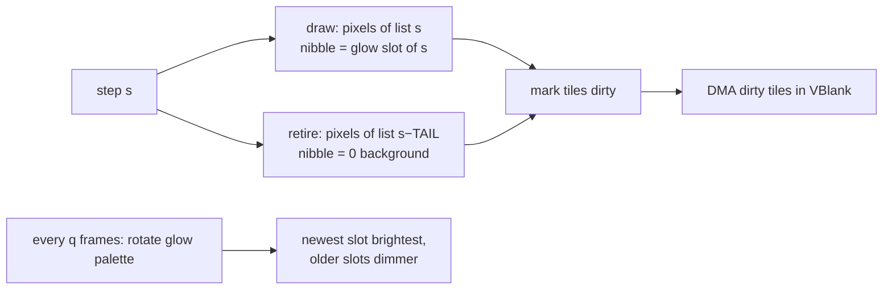

# Thin-line sweep with palette afterglow (design, agreed 2026-10-28)

A real rotating line drawn into plane B's pixels, with a phosphor tail that fades **by palette**.
Each pixel is written once when the sweep reaches it and once when the tail moves past it, and never in between.

## Geometry and budget (computed for a radius-104 disc)
| Item | Value |
|---|---|
| Angle resolution | **256 steps** per revolution (1.41°), painted **two steps every other frame** (halves tile uploads) |
| Rotation | 256 frames = **4.27 s** NTSC (5.12 s PAL); an ASR-9 turns in 4.8 s |
| Disc tiles | **568** of the 26×26 block → RAM copy **18,176 B** |
| Disc pixels | 33,992 → per-step pixel lists **~68 KB ROM** |
| Pixels per step | 98–172 |
| Tiles touched per step | ≤ 20 → ≤ 40 dirty tiles/frame (draw + retire) → **≤ 1.3 KB DMA/frame** |

## Mechanism

- **Glow slots:** PAL0 indices 2..11 (G = 10). A pixel drawn at step `s` gets slot `2 + (s / q) mod G`.
  Every `q` frames the glow palette rotates by one, so the slot just written is brightest and older
  slots step down to dark. Tail = `(G−1)·q` steps (q = 3 → 27 steps ≈ 38°); slots repeat every `G·q`,
  so each pixel is **retired before its slot comes round again** and slots never alias.
- **Rings and ticks are excluded from the pixel lists** at generation time. The sweep never overwrites
  them, so they stay visible under the line and need no restore.
- **The newest step is the "line":** a 1.41° wedge, about 2.5 px wide at the rim, in the brightest colour.
  The fading tail behind it gives the afterglow.

## Data (generated offline, committed)
`tools/scopegen` (Go) writes the following into `res/scope/` (embedded via `res/resources.res`, BIN):
- `scope_tiles`: the 568 base tiles (background + rings/ticks in index 1)
- `scope_map`: the 26×26 tilemap (disc tiles → 568 unique indices; outside the disc → blank tile)
- `sweep_idx[257]` (word offsets) + `sweep_px[]`: per step `nseg`, then per tile segment
  `tile, n_even, n_odd, even byte offsets, odd byte offsets` (offset = tile*32 + px/2 into the RAM copy),
  excluding ring pixels. Drawing ORs nibbles known to be 0; retiring ANDs them; tiles with trail dots take
  a slow path (`trail_cnt`). Measured ~45 scanlines per frame.
The ROM copies `scope_tiles` to RAM once and DMAs it to VRAM. After that it only changes nibbles in RAM and
CPU-copies dirty tiles to VRAM at the start of V-Blank (≤ 48 per frame).

## Invariants
- Frame cost is bounded by the largest step (172 px drawn + 172 retired, ≤ 40 tiles), never by aircraft count.
- Trail dots **are** plane-B pixels (2×2, colour `C_TRAIL`), tracked in a 1-bit-per-pixel map plus
  `trail_cnt[tile]`. Retiring restores `C_TRAIL` where a dot is, so the sweep never erases trails. Tags are on plane A.
- The STARS theme sets `sweep = false`: no drawing, and plane B shows only rings.
- RAM: 18 KB of the ~47 KB the heap has free after SGDK (measured `.data+.bss` = 5.4 KB, stack 2.5 KB).

```c
/* scope.c: one sweep step's pixels, as per-tile segments of byte offsets into the RAM tiles */
static void paint(u8 step, u8 v, bool retire);   /* draw: OR nibble v; retire: AND it back to 0 */
/* scope_advance(): two steps every other frame; retire the tail end first, its slot is reused */
paint((t - TAIL) & 0xFF, C_BG, TRUE);
paint(t & 0xFF, C_GLOW0 + (t / GLOW_Q) % GLOW_SLOTS, FALSE);
```

Related: [screen-layout.md](screen-layout.md).
