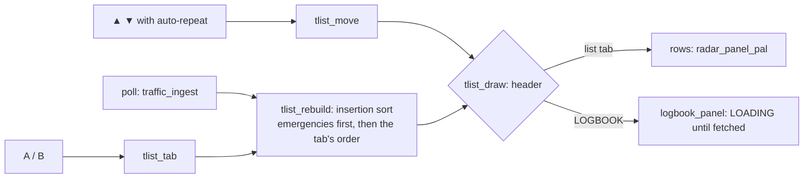

# Panel tabs and the traffic list (`src/tlist.c`)

The side panel's main block holds **tabs**, switched with **A** (next) and **B** (previous): four orders of the
traffic list (NEAREST, LOWEST, HIGHEST, A-Z) and LOGBOOK, whose rows belong to `logbook.c`
([logbook.md](logbook.md)). Owner's decision 2026-11-02 (0.5.0): the old hold-C sort orders became tabs, Z-A
dropped, so A/B (no longer zoom) have a job. ▲/▼ move the selection in the list tabs.

```
row  6  NEAREST 1/5     header: tab name (<= 7) + its number: "%-7s %u/%u"
row  7  UAL2414 0.5     LIST_ROWS (15) entries: cs cut to 7, a space, distance (3 chars)
 ...    SWA692  5.6     selected: PAL2 (cyan); emergency: PAL_TEXT_EMERG (red); others PAL0
row 21  N8065L   14
row 22  ^2 v11 MORE     hidden above / below; blank when everything fits
```

## Behaviour
- **Tabs** = `settings.sort` (saved, [config-screen.md](config-screen.md)), `enum sort_mode` values fixed for old
  records: NEAREST 0, A-Z 1, Z-A 2 (no tab: `settings_load` turns it into A-Z), LOW ALT 3, HIGH ALT 4, LOGBOOK 5.
  Tab order `tabs[] = { NEAREST, ALT_LOW, ALT_HIGH, AZ, LOGBOOK }`, names NEAREST, LOWEST, HIGHEST, A-Z, LOGBOOK.
  `tlist_tab(d)` steps (wrapping), saves (`settings_changed`), rebuilds, and on LOGBOOK fetches the log (blocking).
- **On LOGBOOK** the list is still sorted (as NEAREST) so selection, ▲▼, the pop-up and ambient mode keep working;
  `tlist_draw` writes only the header and hands the rows to `logbook_panel()`. Drawing a list tab calls
  `logbook_forget()` (its rows are gone).
- Emergencies (`AR_F_EMERG`) come first in every order. Ties keep slot order, so the list is stable.
- **Altitude key:** ground lowest, unknown altitude after every known one in both altitude orders.
- **Data:** the `[main]` side of the track table (`tracks[i].next`, used && !drop), so it never races the V-Int.
  Distance = `isqrt32(x² + y²)` in 1/32 nm, computed once per rebuild.
- **Rebuild** (`tlist_rebuild`): after every poll (once per sweep), on a tab change, and when `radar_up()` empties the
  table. Not continuous, so rows don't jump under the cursor.
- **Selection** is a track slot (`radar_select`), so it follows the aircraft, not the row. A dropped aircraft
  clears it. `scroll_to` keeps it on screen. `tlist_move(d)` clamps at the ends; `tlist_move(0)` selects the top if
  none (the pop-up uses it). TAGS SEL mode retags on every move.



## Contracts
- Main loop only (it calls `radar_panel_pal`). `tlist_draw(row)` must run once before `tlist_rebuild` redraws (it
  records the first row; `panel_static` does both).
- `radar_panel_pal` is a no-op when the row's text and palette are unchanged, so redrawing all rows each sweep
  costs nothing on the V-Int when little moved.

```c
/* main.c panel rows */
ROW_LIST,                               /* tab header, LIST_ROWS entries, "more" (tlist.c) */
ROW_SEP = ROW_LIST + LIST_ROWS + 2, ROW_MODES, ROW_DATA1, ROW_DATA2,
```

Related: [logbook.md](logbook.md), [screen-layout.md](screen-layout.md), [detail-popup.md](detail-popup.md).
