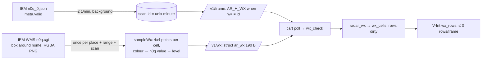

# Weather overlay (`src/wx.c`, `radar.c`; relay `wx.go`, `wxpal.go`)

Precipitation from NOAA NEXRAD shows on the scope behind the traffic, as a STARS display draws it: coarse cells
(the scope's 8×8 px tiles), three stipple densities. The relay turns the Iowa Environmental Mesonet's (IEM) n0q
composite into 26×26 levels at the cart's range; the cart draws them on plane A at low priority. Default ON;
setup's WEATHER row or **Z** (6-button) turns it off. US only (CONUS); elsewhere the scope stays clear.



## Data source (relay `wx.go`)
- **Scan time:** `GET <-wx>/data/gis/images/4326/USCOMP/n0q_0.json` → `meta.valid` (RFC 3339). Id = unix minute & 0xFFFF,
  never 0. Checked at most once a minute (`wxCheckEvery`): in the background from a frame request (a frame never
  waits), synchronously from `/v1/wx`.
- **Picture:** WMS `GetMap LAYERS=nexrad-n0q SRS=EPSG:4326 TRANSPARENT=TRUE FORMAT=image/png` for `wxBox`: the scope's
  square around home at the range, +5 %; size ≈ the composite's 0.005° pixels, clamped 64-400 px a side.
- **Colour → value:** WMS draws with the composite's own 256-colour palette (`n0qPalette` in `wxpal.go`, read from
  `n0q_0.png`'s PLTE; all 256 unique, verified 2026-11-02: every WMS pixel matched). Value v = v/2 − 32.5 dBZ.
  Transparent or unknown → 0. Levels: **1** light 20-35 dBZ (v ≥ 105), **2** moderate 35-50 (≥ 135), **3** heavy 50+ (≥ 165).
- Why not the full composite PNG: 12200×5400, 4.2 MB per scan. Why not tiles: web-mercator, and still colours.
- **Sampling** (`sampleWx`): per cell, 4×4 points at pixel centres (1, 3, 5, 7 px), unprojected from the frame's
  azimuthal equidistant projection (`unproject`, inverse of `distBearingNM`); points off the 104 px disc count as 0.
  A cell takes the highest level that ≥ 4 of its 16 points reach (a lone hot pixel doesn't paint a 7 nm cell).
- **Coverage:** box outside lon −126..−65, lat 23..50 → `AR_W_NONE`, no picture fetched.
- **Cache:** `wxKey` (lat/lon at 1e-4°, range) → grid + scan time, 32 kept (least recently used out). A newer scan
  refetches; a failed fetch serves the old grid (`AR_W_OLD` once > 15 min) or 502 if there's none.
- `-wx ""` (`RELAY_WX=`): no source. Frames never flag; `/v1/wx` answers id 0 + `AR_W_NONE`.

## Contract (v5, [../architecture/contract.md](../architecture/contract.md))
```c
#define AR_H_WX     0x08        /* weather other than the request's w= is waiting */
#define AR_FRAME_QUERY  "?lat=%s&lon=%s&range=%u&max=%u&n=%u&w=%u&v=%u"
#define AR_WX_QUERY "?lat=%s&lon=%s&range=%u&v=%u"      /* AR_WX_PATH "/v1/wx" */
struct ar_wx { char magic[2]; u8 ver, wflags; u16 id, range_nm; u8 cells[26 * 7]; };   /* "AW", 190 B */
```
- Cells: 26 rows from the north, 7 bytes each, 4 cells a byte, west first, high bits first. Cell (c, r) is
  plane A cell (c + 1, r + 1). `wflags`: `AR_W_NONE` (no coverage), `AR_W_OLD` (scan > 15 min old).
- `w=` is the id the cart holds (0 = none); a **missing** `w=` never waits. The flag is "different", not "newer".

## Cart (`wx.c`, main loop)
`wx_check()` runs after each good poll (after the notice and alert checks). It fetches when the range on screen isn't the
range fetched (`range`, 0 after `wx_reset()` in `radar_up` and after a zoom wipes the cells) or the frame flags
`AR_H_WX`. A failed fetch waits `RETRY_SECS` (60) so a relay without its source doesn't cost a GET per sweep (its
failure count is reset by the next good frame, so it never forces a reconnect). WX_OFF: `radar_wx(NULL)`, no fetches;
Z calls `wx_check()` at once when turning it off. `wx_shown()` drives the panel credit: `adsb.fi IEM` (row 26,
only if it fits 11 chars).
`feed_relay.c` keeps `wx_held` (sent as `w=`) and `wx_flag`; `feed_fake.c` serves `res/fake/wx.bin`.

## Renderer (`radar.c`)
- **Layers:** weather = plane A, **low priority**, PAL0 colour `C_WX` (13). The scope (plane B) is now **high
  priority** (`scope.c`), so rings, sweep and trail dots draw over the stipple; tags (plane A high) still win; blips
  are high-priority sprites. Text cells hide the weather in that cell (one plane A word per cell): tags win.
- **Tiles:** `t_wx = t_lead + 4`, 3 tiles: 25 % (diagonal lattice), 50 % (checkerboard), 75 % (inverse of 25 %),
  periods 2/4 px so neighbouring cells join.
- **State:** `wx_cells[182]` (the wire cells, copied under ints-off by `radar_wx`), `wx_dirty` (u32, bit r = row r + 1).
  `wx_word(x, y)` = the cell's tile word or 0 (shifts only: `(r << 3) - r`, no multiply).
- **Every blank write restores weather:** `row_clear` (tag and leader erase, `clear_labels`), `tag_row` (spaces in a
  tag show the weather), `box_rows` (cells the shrinking notice box leaves).
- **Full redraw** `wx_rows()`: ≤ `WX_PER_FRAME` (3) rows a frame, after `box_tick`; skips cells whose `grid` low
  nibble is set (text there). A tag's gap column is marked `GAP` (0x10) in `grid` (`tag_mark`), so it still
  blocks placement but gets weather. A zoom wipes `wx_cells` (sampled at the old range) in `radar_rescale()` itself (main, ints off, so a fetch right
  after the zoom can't be wiped by a V-Int rescale still pending) and the V-Int rescale dirties all rows.
- Cost: 26 words/row, ~5 lines a frame while redrawing (9 frames per refresh), nothing in steady state.
  No `jsr __` added in `radar_vint`.

```c
static u16 wx_word(s16 x, s16 y)
{
    if (x < 1 || y < 1 || x > AR_WX_N || y > AR_WX_N) return 0;
    u16 r = y - 1, c = x - 1;
    u8 l = (wx_cells[(r << 3) - r + (c >> 2)] >> (6 - ((c & 3) << 1))) & 3;
    return l ? TILE_ATTR_FULL(PAL0, FALSE, FALSE, FALSE, t_wx + l - 1) : 0;
}
```

## Theme colours (PAL0 13, dim: below every text colour)
Classic `0x840`, STARS `0xA42`, AMBER `0x444`, NIGHT `0x404`, MARINE `0x842`, ICE `0x480`, POCKET `0x064` (darker
than the pea-green background), SUNSET `0xA46`, ERAM `0x840` (0x0BGR). The first set (about half as bright: `0x420`
...) made a lone light cell nearly invisible on the owner's TV (2026-11-02); the brighter set still sits under the
tags in MAME. Tune further on a TV.

## Emulator + tests
- `res/fake/wx.bin` (`make fake-feed`): `relay -pack-wx` samples `relay/testdata/wx/kmco-100nm.png` (a moderate/heavy
  band around KMCO, scan 2026-11-02 16:40Z, id 9544, recorded with `relay -record-wx … -range 100`) for each range
  5-100 nm; "FW", u16 count, `struct ar_wx` each. The sim shows that storm around KBNA; `feed_wx_waiting()` is
  always FALSE (fetched at start and after zooms).
- `wx_test.go`: level thresholds, unproject round trip, sampling the recording (corners clear, light + moderate,
  heavy at 100 nm), packing, handler against a fake IEM (`fakeIEM`: cache hit, coverage, the frame flag by `w=`),
  `-wx ""`. `contract_test.go` maps `ar_wx`, `AR_WX_*`, `AR_W_*`, `AR_H_WX` and checks the queries.
- Live (2026-11-02): `/v1/wx?lat=36.1245&lon=-86.6782&range=100&v=5` → id 9549, 76 ms; a frame with another `w=`
  carries 0x08.

## Lessons
- A frame can't flag weather before the relay's first background scan check: the cart fetches on its first poll
  anyway (`range` 0), so nothing waits on the flag.
- Real tags cover whole cells, so dense traffic over rain reads as holes in the stipple: accepted (tags win).

Related: [radar-renderer.md](radar-renderer.md), [screen-layout.md](screen-layout.md), [config-screen.md](config-screen.md),
[../relay/relay.md](../relay/relay.md), [../architecture/frame-format.md](../architecture/frame-format.md).
